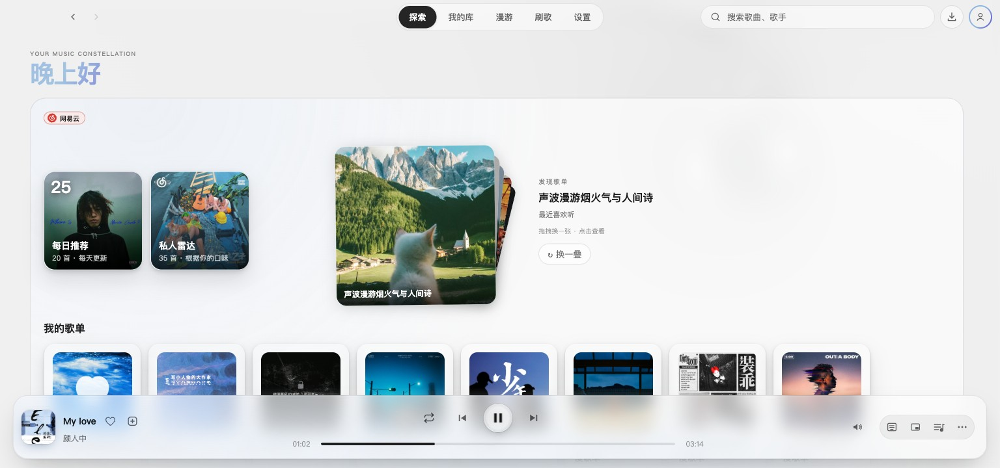
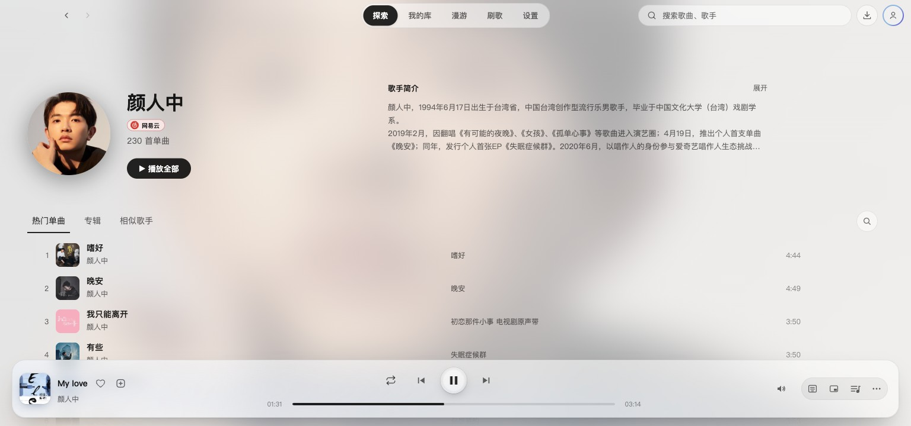
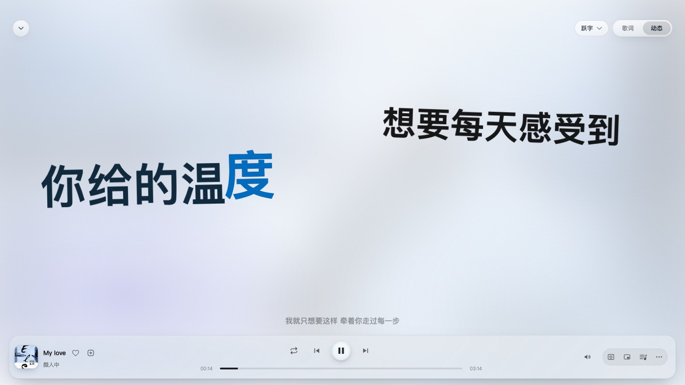
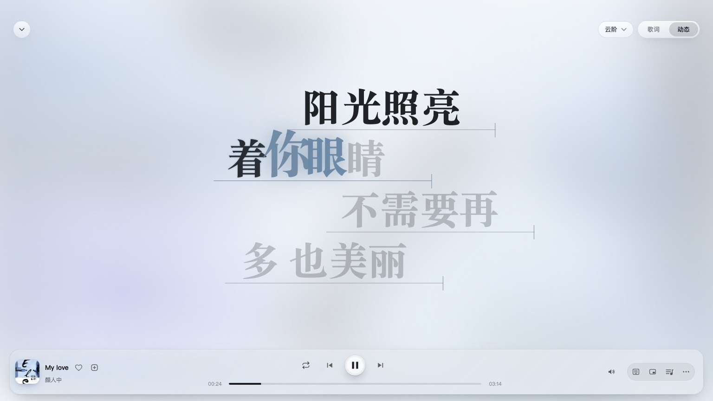
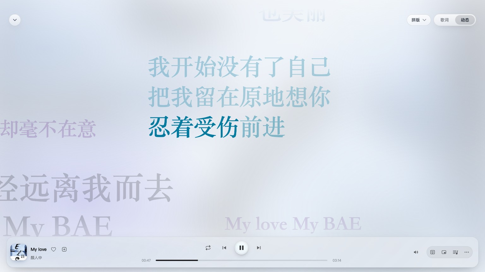
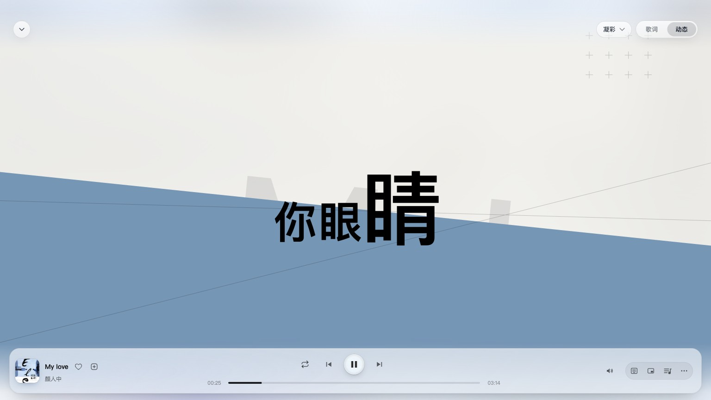
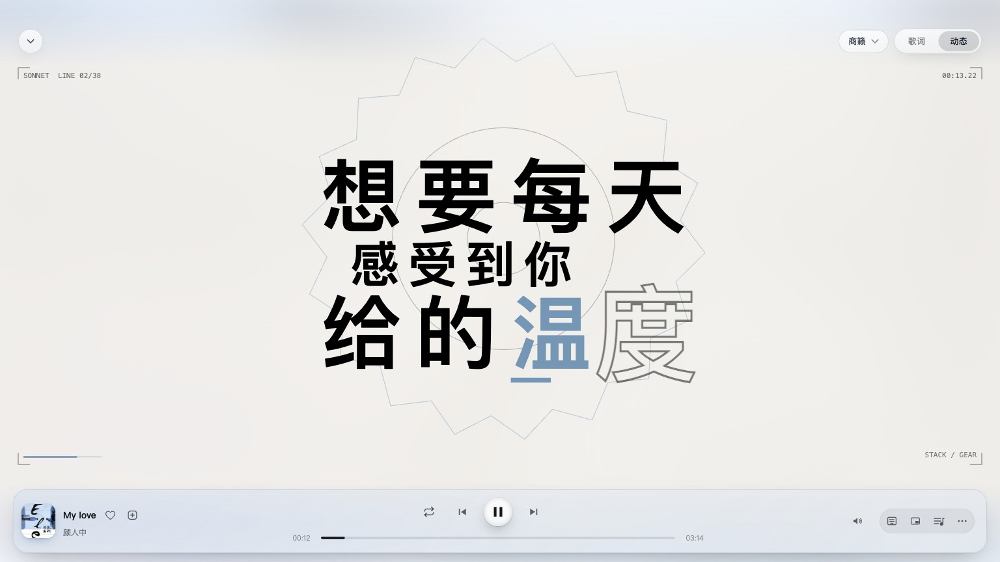
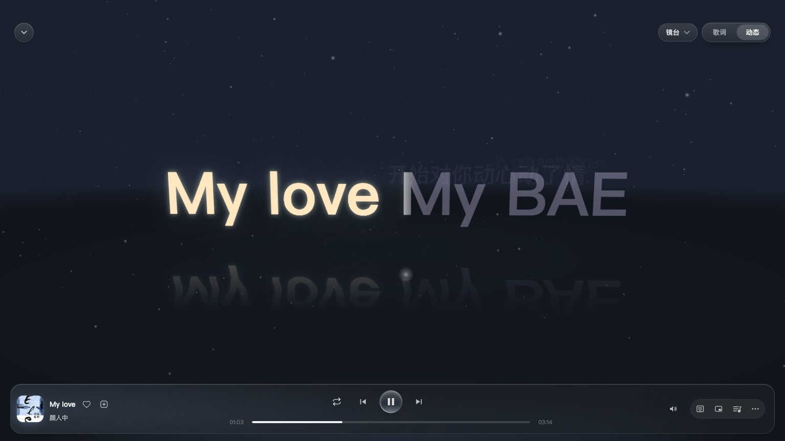
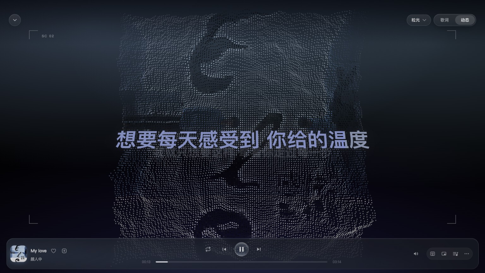

<div align="center">


# Simple Music

支持网易云音乐、QQ 音乐、Apple Music 和本地音乐的桌面播放器。<br>
适用于 macOS 和 Windows。

[下载安装](#下载安装) · [功能](#功能) · [截图](#截图) · [开发文档](./docs/README.md) · [问题反馈](https://github.com/Yyyangshenghao/simple-music/issues)

</div>

[](./docs/screenshots/showcase/lyrics.jpg)

## 功能

- **音乐搜索**：搜索歌曲、歌手、专辑和歌单，支持按平台与类型筛选。
- **推荐与曲库**：浏览各平台的推荐、收藏和歌单，查看歌手资料、热门歌曲、专辑与相似歌手，支持歌手关系漫游。
- **刷歌**：自动选取歌曲片段试听，支持上下切歌、加入歌单和播放全曲。
- **歌单管理**：管理网易云、QQ 的自建歌单，也可以创建保存在本机的应用歌单，将四种来源的歌曲放在一起整理。
- **本地音乐**：添加音乐文件夹，读取歌曲标签、内嵌封面、同名 `.lrc` 和内嵌同步歌词。
- **歌词显示**：支持滚动歌词、逐字高亮、翻译、音译，以及跃字、云阶、拼版、凝彩、商籁、镜台、粒光七种动态样式。
- **歌词来源选择**：支持网易云、QQ、AMLL 逐字歌词库与酷狗歌词库，可调整查找顺序、预览候选，并记住单首歌曲的选择。
- **播放控制**：播放队列、下一首播放、顺序调整、断点续播、睡眠定时，以及可配置的应用内和全局快捷键。
- **桌面功能**：桌面歌词、迷你播放条和 Windows 动态桌面壁纸。
- **游戏模式**：收起主界面，后台继续播放；保留托盘控制和已开启的桌面歌词。
- **下载与离线**：网易云、QQ 的可下载歌曲支持单曲和批量下载，提供下载队列、播放缓存和离线保留。
- **界面设置**：深浅主题、封面取色、自定义主题色、字体和动效；支持流体、图片、视频和 Wallpaper Engine 应用背景。

## 截图

| 探索页 | 歌手页 |
|:---:|:---:|
| [](./docs/screenshots/showcase/explore.jpg) | [](./docs/screenshots/showcase/artist.jpg) |

| 动态歌词：跃字 | 动态歌词：云阶 |
|:---:|:---:|
| [](./docs/screenshots/showcase/lyrics-pop.jpg) | [](./docs/screenshots/showcase/lyrics-partita.jpg) |

| 动态歌词：拼版 | 动态歌词：凝彩 |
|:---:|:---:|
| [](./docs/screenshots/showcase/lyrics-fume.jpg) | [](./docs/screenshots/showcase/lyrics-tempera.jpg) |

| 动态歌词：商籁 | 动态歌词：镜台 |
|:---:|:---:|
| [](./docs/screenshots/showcase/lyrics-sonnet.jpg) | [](./docs/screenshots/showcase/lyrics-diorama.jpg) |

**动态歌词：粒光**

[](./docs/screenshots/showcase/lyrics-stage3d.jpg)

截图来自实际运行的应用，点击可查看原图。拍摄环境与内容来源见 [截图记录](./docs/screenshots/showcase/README.md)。

## 刷歌

从顶栏进入「刷歌」，逐首试听推荐歌曲的片段。应用会根据歌词尝试定位副歌或重复段；没有合适的歌词时，按歌曲时长选取片段。

滚轮、上下拖动或 ↑ / ↓ 可切换歌曲，片段播完也会自动进入下一首。可以直接加入歌单、标记喜欢、选择「不感兴趣」或「播放全曲」，也可以点击「换一批」获取更多歌曲。推荐来自已登录并启用的首选播放平台。

[](./docs/screenshots/showcase/shuange.jpg)

## 桌面歌词

从播放栏开启桌面歌词，不打开主窗口也能查看。支持单行或双行、逐字高亮、翻译和音译，可调整字体、字号、颜色、透明度与底框；双行显示当前句和下一句。锁定后歌词窗口可穿透鼠标，避免影响其他操作。

桌面歌词的外观设置位于「设置 → 歌词与特效 → 桌面歌词」。下图为实际播放中的双行歌词。

[](./docs/screenshots/showcase/desktop-lyrics.png)

## 游戏模式

在「设置 → 界面与窗口 → 游戏模式」或托盘菜单中开启。主界面会收起，音乐在后台继续播放；迷你播放条和动态桌面壁纸暂时关闭，仍可通过托盘或已启用的全局快捷键控制播放。

已开启的桌面歌词继续显示，临时改为单行暗底，并关闭逐字高亮与宽度自适应。下图是进入游戏模式后的同一首歌。退出模式后会恢复原有歌词设置；在托盘选择「显示主窗口」可返回主界面。

[](./docs/screenshots/showcase/game-mode-lyrics.png)

## 下载安装

前往 [Releases](https://github.com/Yyyangshenghao/simple-music/releases/latest)，选择对应系统的安装包。

| 系统 | 文件名后缀 | 安装方式 |
|---|---|---|
| macOS · Apple 芯片 | `-arm64.dmg` | 打开镜像，将应用拖入「应用程序」 |
| macOS · Intel 芯片 | `-x64.dmg` | 同上 |
| Windows · x64 安装版 | `-Setup.exe` | 按安装向导操作 |
| Windows · x64 便携版 | `-portable.exe` | 双击运行，更新时重新下载 |

Mac 芯片类型可在苹果菜单 →「关于本机」查看。应用内「设置 → 关于应用」提供检查更新和更新日志入口；macOS 下载后需手动替换安装，Windows 便携版需自行更新。

## 使用说明

1. 进入「设置 → 音源与账户」，登录并启用需要使用的平台。
2. 通过顶栏搜索或探索页播放歌曲，点击播放栏封面进入歌词页，可切换普通歌词和动态歌词。
3. 在「我的库」管理歌单；导入本地音乐时，进入「我的库 → 本地音乐 → 添加文件夹」。
4. 播放栏提供桌面歌词和迷你播放条开关，外观、背景和快捷键可在设置中调整。

### 音源与账号

| 来源 | 播放要求 | 下载与离线 |
|---|---|---|
| 网易云音乐、QQ 音乐 | 分别登录并启用，歌曲与音质受账号权限、版权及平台服务限制 | 支持可用歌曲的下载、播放缓存与离线保留 |
| Apple Music | 需要有效订阅和可用连接，使用独立的受保护播放会话 | 不提供音质档位、倍速、音频下载或离线缓存 |
| 本地音乐 | 无需在线账号 | 直接播放本机原文件 |

网易云与 QQ 可在播放失败后，按设置顺序尝试其他已启用平台的同曲版本。Apple Music 不参与跨平台音频替换，AMLL 与酷狗仅提供歌词。

应用歌单保存在本机，编辑不会修改平台歌单，也不会自动同步到平台。

### 歌词

逐字时序、翻译和音译取决于歌曲及歌词来源；缺少真实逐字时序时，部分动态样式会估算展示节奏。手动选择歌词来源不会改变音频来源。

本地歌曲优先读取同名 `.lrc` 或内嵌同步歌词；没有本地歌词且标签齐全时，才尝试在线匹配。Apple Music 的频谱效果取决于系统是否允许捕获受保护音频，不影响正常播放。

### 下载与缓存

下载歌曲会保存到指定的下载目录，支持在队列中查看进度、暂停、取消和重试。

播放器缓存分为自动缓存和固定保留的离线音频。自动缓存可能随容量清理；需要保留时可选择「保留此缓存」，随后在「我的库 → 离线音乐」中播放。清理播放器缓存不会删除下载目录中的歌曲文件。

### 壁纸背景

Wallpaper Engine 应用背景读取本机 Steam 已订阅的壁纸文件：视频、网页和场景型可播放，场景型可调整帧率、画质、音乐响应和鼠标交互；应用型仅显示封面，具体兼容性取决于壁纸内容。文件不会复制到应用中，取消订阅后可能需要重新选择。

将播放器可视化场景设为桌面壁纸的功能仅支持 Windows。

## 本地开发

项目使用 Electron（CastLabs ECS）、React、TypeScript、Zustand、electron-vite 和 Three.js。

```bash
npm ci
npm run dev           # 启动桌面应用与内嵌 API
npm run typecheck     # 检查主进程与渲染层类型
npm test              # 运行测试
```

独立 API 调试使用 `npm run server:dev`。开发模式下，Apple Music 受保护播放使用本机 Chrome；正式安装包通过 CastLabs EVS 签名后使用应用内窗口。

更多说明见 [文档导航](./docs/README.md)、[协作规范](./CONTRIBUTING.md) 和 [构建与发布](./docs/build-and-release.md)。

## 问题反馈

遇到问题或有功能建议，请提交 [Issue](https://github.com/Yyyangshenghao/simple-music/issues)。反馈问题时请附上应用版本、系统与芯片类型、复现步骤，以及相关截图或日志。

## 免责声明

本项目为个人学习与技术交流用途，不是网易云音乐、QQ 音乐或 Apple Music 的官方产品，也不代表相关平台。项目不托管或分发音乐内容；音频缓存与离线保存发生在使用者本机。请遵守所用平台的服务条款与适用法律。若相关权利方认为本项目存在侵权内容，请联系作者处理。

## 鸣谢与来源

- **[XxHuberrr/Mineradio](https://github.com/XxHuberrr/Mineradio)（GPL-3.0）**—— 本项目的起点。Simple Music 最初是这个项目的移植式重写：整体架构（Electron 主进程模块化、React + TypeScript 渲染层、electron-vite 构建、跨平台适配）已经完全重写，但 `server/lib/dj-analyzer.ts` 的 BPM/节拍分析算法、`electron/platform/win32.ts` 的桌面壁纸注入与鼠标轮询脚本、`server/routes/*` 部分接口的业务逻辑，是在保留原有算法/逻辑的前提下移植为 TypeScript 的，属于 GPLv3 意义上的衍生代码。这也是本项目 license 是 GPL-3.0 而不是更宽松协议的原因。
- [NeteaseCloudMusicApi](https://github.com/Binaryify/NeteaseCloudMusicApi)（MIT，Binaryify）—— 网易云音乐接口封装，作为直接依赖使用。
- [Folia](https://github.com/chthollyphile/folia-major) —— 动态歌词样式与交互的参考，本项目按自身架构重新实现。
- [React Bits](https://github.com/DavidHDev/react-bits) —— 部分界面组件、交互动效与流体背景的来源和参考。
- [AMLL TTML DB](https://github.com/amll-dev/amll-ttml-db) 及其贡献者 —— 提供社区制作的逐字歌词。
- QQ 音乐接口部分在实现与文档整理时参考、交叉核对了以下开源逆向项目（均未直接引入代码，接口来源见 [QQ 音乐接口文档](./docs/qq-music-api.md)）：[l-1124/QQMusicApi](https://github.com/l-1124/QQMusicApi)（Python）、[copws/qq-music-api](https://github.com/copws/qq-music-api)（JS）、[jsososo/QQMusicApi](https://github.com/jsososo/QQMusicApi)（Node.js）。

上述网易云与 QQ 音乐接口项目均为非官方实现，QQ 音乐、网易云音乐无面向个人开发者的公开 OpenAPI，相关接口存在随上游改版失效的风险。

## License

[GPL-3.0](./LICENSE) © yshAM

沿用参考项目 [Mineradio](https://github.com/XxHuberrr/Mineradio) 的 GPL-3.0 协议：可以自由使用、修改、分发，但基于本项目的二次分发（包括分发编译后的安装包）也必须遵循 GPL-3.0，公开对应源码。
