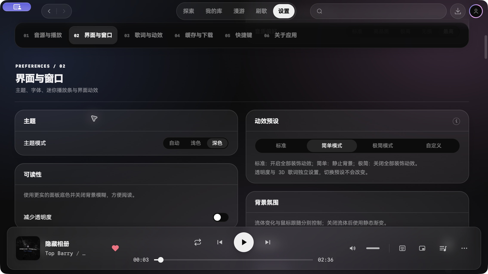
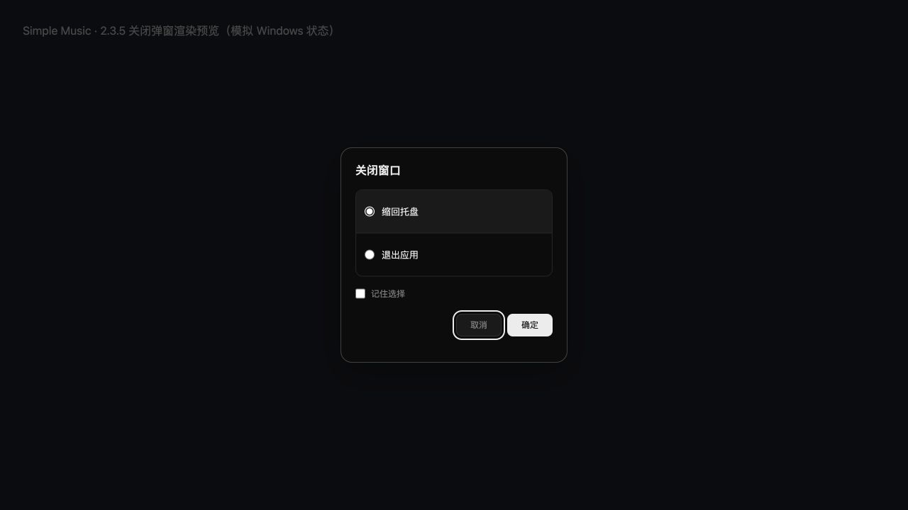

# 2.3.5 发布复核

## 范围与结论

基准为 `v2.3.4`，复核 `dev/2.3.5` 已集成的缓存与桌面修复、视觉设置、Windows 关闭交互，以及本轮漫游补充修复。独立复核按桌面与更新、视觉设置、缓存与漫游三个范围分别执行。

发现并修复一处漫游状态遗漏：网易云生成请求等待期间直接确认歌手会让旧会话失效，却未复位 `generating`，使生成按钮持续禁用。确认歌手时立即解除旧生成状态；新增旧请求成功、失败两条回归，先复现失败，再确认修复通过，并验证可以再次生成。其余范围未发现可证实的发布阻塞。

## 验证

- 类型检查通过；全量 225 个测试文件、1,955 项测试通过；源码构建通过。
- 桌面独立复核另运行 11 个文件、163 项测试；视觉独立复核运行 8 个文件、64 项测试；缓存与漫游独立复核运行 4 个文件、89 项测试。本轮补充修复后漫游 45 项测试通过。
- macOS 开发应用已检查深浅主题、视觉设置、减少透明度与歌单预览；关闭弹窗在 Chromium 渲染预览中检查选择后确认、记住选择、键盘导航与失败重试。截图中的关闭状态为模拟 Windows 桥接，不能替代 Windows 原生窗口验收。
- Release 工作流负责双平台类型检查、全量测试、生产 VMP 签名、打包和必需产物校验；发布结果以对应运行记录为准。

## 剩余验证边界

- 未具备 Windows 实机，原生窗口关闭、托盘、全屏 Esc、无响应兜底和 NSIS 更新安装尚需对应环境验收。
- 未测量真实 GPU 显存、功耗或长时间反复切换场景的资源变化。
- 当前仓库未启用 master 分支保护或 ruleset，PR/dev/master 自动检查尚未配置；本轮采用本地验证与独立复核，不宣称存在自动门禁。

## 界面记录

