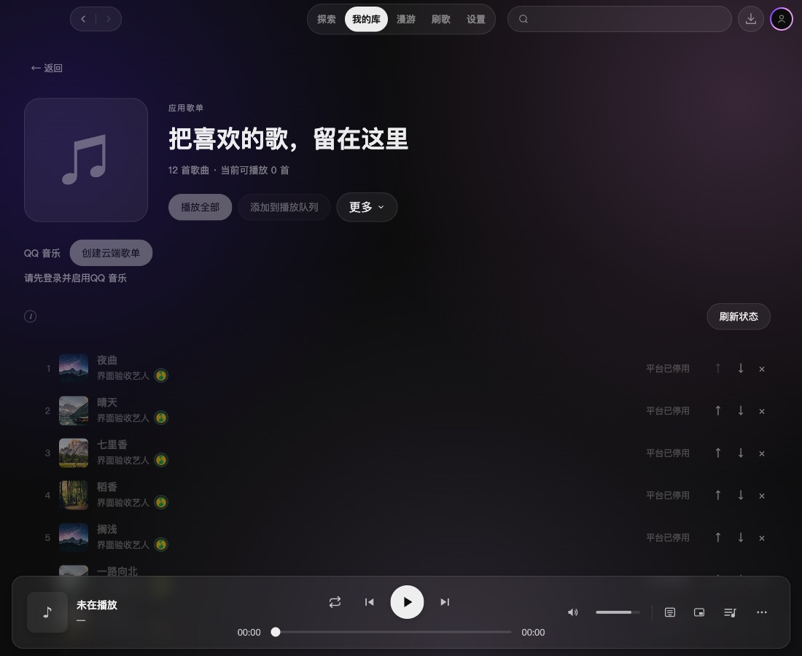
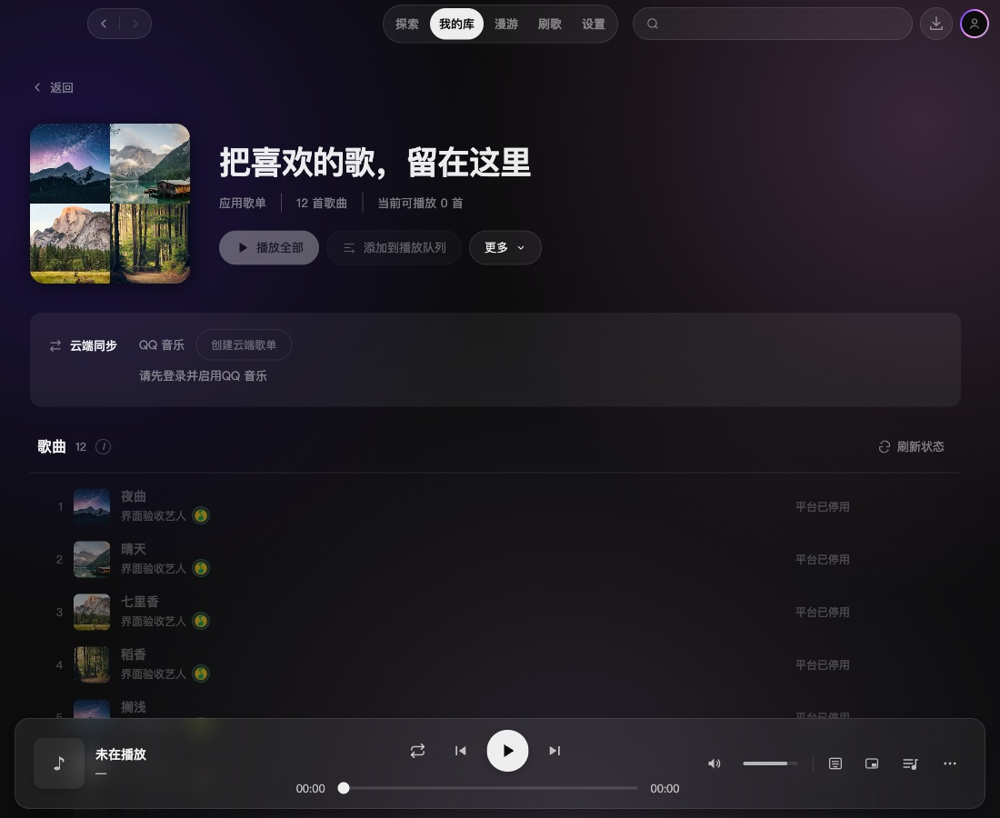

# 2.4.0 应用歌单详情页美化

范围为应用歌单内部的 `AppPlaylistPage`，保留现有主题、系统字体和业务操作。以改前详情页及现有 `TrackRow` 为参考，沿用 58px 行定位，调整内容层次与分组密度。

- 顶部展示前四张不同的歌曲封面；不足四张时展示首张，无封面或加载失败时保留音符回退。
- 歌单名为视觉重心，类型、数量和可播放数放在同一信息行；播放全部保留唯一主要强调。
- 同步控件集中在次级区域，保留登录条件、同步限制和变更风险提示。
- 曲目列表补上标题与数量；排序、移除用统一线性图标，鼠标悬停或键盘焦点进入行时显示，触屏直接显示。
- 样式限制在详情页，不修改歌单总览、共享曲目组件和同步业务逻辑。

| 修改前（1100×900） | 修改后（1100×900） |
| --- | --- |
|  |  |

[浅色 960px](assets/2.4.0-app-playlist-detail-polish/after-light-960.jpg) · [长名称](assets/2.4.0-app-playlist-detail-polish/after-long-name-960.jpg) · [最小窗口 960×540](assets/2.4.0-app-playlist-detail-polish/after-minimum-dark.jpg) · [空歌单](assets/2.4.0-app-playlist-detail-polish/after-empty-light.jpg) · [混合来源](assets/2.4.0-app-playlist-detail-polish/after-mixed-dark.jpg) · [封面加载失败](assets/2.4.0-app-playlist-detail-polish/after-broken-cover-light.jpg)。

## 验证

- `npm run typecheck` 通过；`npm test` 271 文件、2660 用例通过。
- `npm run dev` 使用隔离配置启动真实 Electron；通过 CDP 检查深浅主题、最小视口、长名称、空态、混合来源和失效封面，无横向溢出或页面异常。
- 真实控件检查：重命名保存与焦点恢复、键盘下移歌曲、移出歌单、刷新状态、Escape 关闭更多菜单。独立复核发现的同步按钮特异性问题已修正并复核。
- 设计检测器无发现。最后仅调整局部 CSS 特异性，随后复核并检查实际截图；无安装包构建。

截图使用 12 首模拟曲目及 Unsplash 测试图片；风景封面不是歌曲实际封面，不作为产品内置资产。前后对比在同一路径中通过临时 Vite transform 加载改前源码，最终已恢复当前源码并重启应用；CDP 视口截图不包含原生窗口边框。没有执行真实播放或云端写入，未验证 Windows。

[结构化验证记录](2.4.0-app-playlist-detail-polish-verification.json)。
