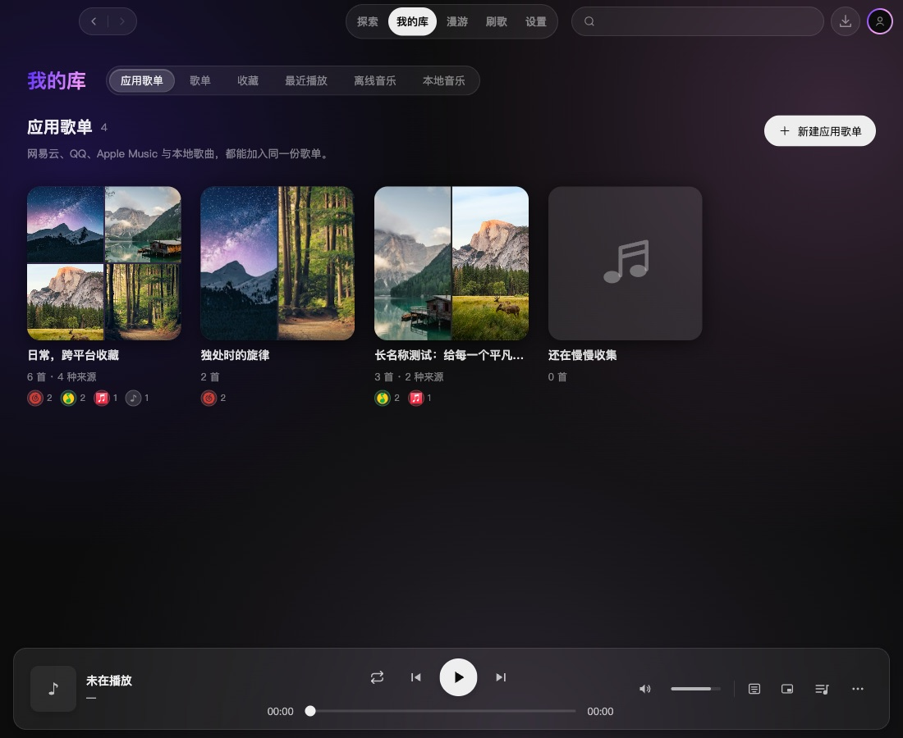
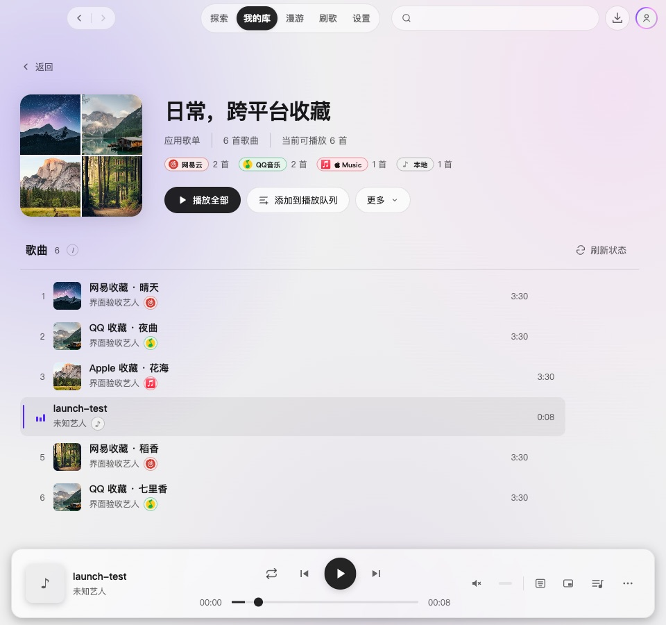

# 2.4.0 应用歌单聚合展示验收

所属版本为 2.4.0，阶段目标为 `dev/2.4.0`。应用歌单作为“我的库”的默认入口，聚合网易云、QQ、Apple Music 和本地歌曲；平台歌单继续负责平台侧管理。本轮不改变播放引擎、平台写入或存档格式。

## 页面与交互

- 总览和详情共用歌曲封面拼图，优先覆盖不同来源，支持一至四张；没有图片或加载失败时显示音符。来源数量按保存的全部曲目计算，平台停用不会让来源消失。
- 总览显示歌曲总数、来源构成和完整名称提示；详情分别显示收藏数量和当前可播放数量。新建成功后直接进入详情，空态给出加入入口。
- 加入应用歌单弹窗显示目标的歌曲数和来源构成，按钮的读屏名称包含相同信息。所有整理仍仅写入应用存档。

## 实际界面

[首次使用](assets/2.4.0-app-playlist-launch/empty-dark.jpg) · [浅色总览与长名称](assets/2.4.0-app-playlist-launch/overview-light-960.jpg) · [最小窗口 960×540](assets/2.4.0-app-playlist-launch/mixed-detail-minimum.jpg) · [不可播放仍保留收藏](assets/2.4.0-app-playlist-launch/unavailable-preserved-light.jpg) · [加入目标来源](assets/2.4.0-app-playlist-launch/add-target-sources-dark.jpg) · [存储失败反馈](assets/2.4.0-app-playlist-launch/save-failure-dark.jpg)。

截图来自 macOS 真实 Electron 开发应用的独立临时配置，CDP 设置逻辑视口，不含原生边框。云端曲目、登录态和接口响应是测试数据，风景图片仅用于验收封面；本地曲目使用真实索引文件。

## 验证结果

- `npm run typecheck` 通过，`npm test` 共 274 文件、2561 项测试通过。新增四源身份与恢复、分批加入、同源去重、跨源同 ID、不可用保留、离线边界、换号/取消、播放队列复制及平台写入零调用检查。
- 实际 Electron 验证默认入口、新建后跳转、四源数量、键盘排序、移除、改名、重新读取存档和真实更多菜单加入已有目标。深浅主题、长名称和最小窗口无横向溢出，最小窗口可滚动到最后一首并避开播放器。
- 真实本地 WAV 经本地索引、IPC 和播放宿主静音播放，状态进入 `playing` 且进度增长。在线平台全部停用时仅本地入队，六首收藏仍保留；移走真实文件并刷新后播放禁用，恢复文件后重新可播。
- 四源都可用时，在播放命令接缝记录六首歌曲的来源与顺序；该项没有调用真实云端音频。模拟存储空间不足后保留弹窗和输入、展示错误且不产生歌单。
- UI 流程无页面异常、无平台歌单写入。设计检测返回空结果；独立复核完成，修复目标按钮读屏信息被覆盖的问题，并补回归测试。实际截图发现的封面非正方形已修正并以尺寸断言确认。

真实云端音频、Apple Music 受保护会话和 Windows 实机未验收；不将模拟登录和命令接缝验证计作真实云端端到端通过。未构建安装包、升级版本或发布。

[实施范围](../specs/2026-10-18-app-playlist-launch.md) · [结构化界面验证](2.4.0-app-playlist-launch-verification.json)。
