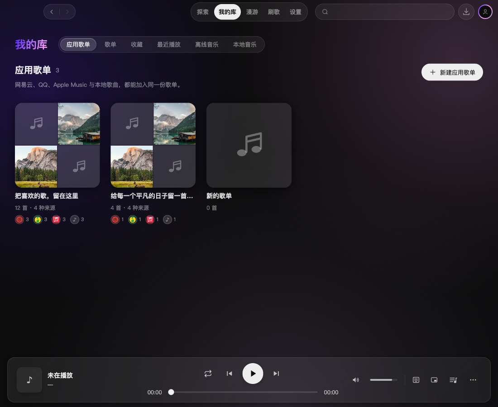
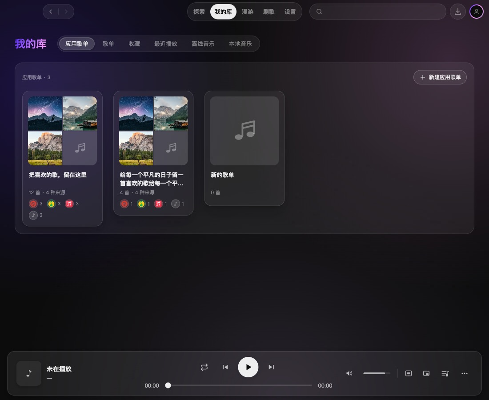
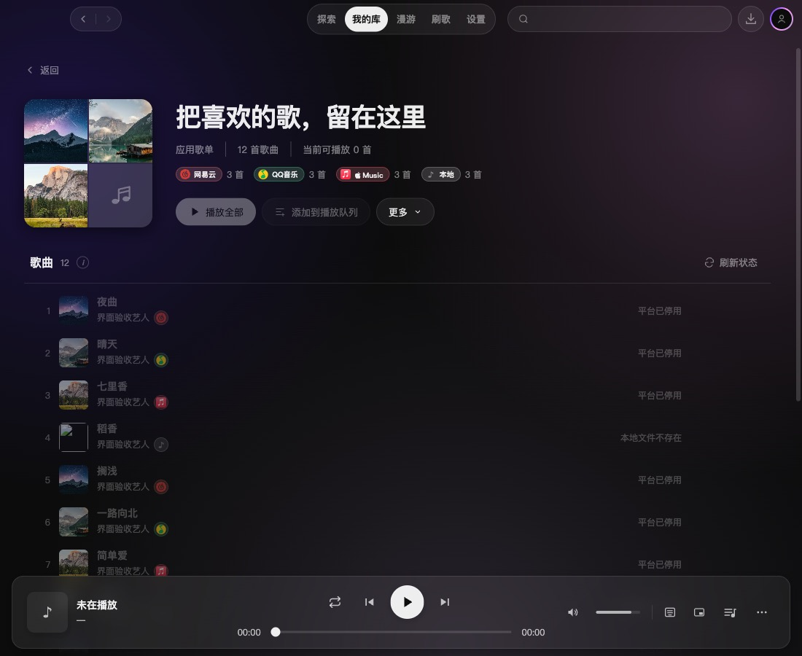
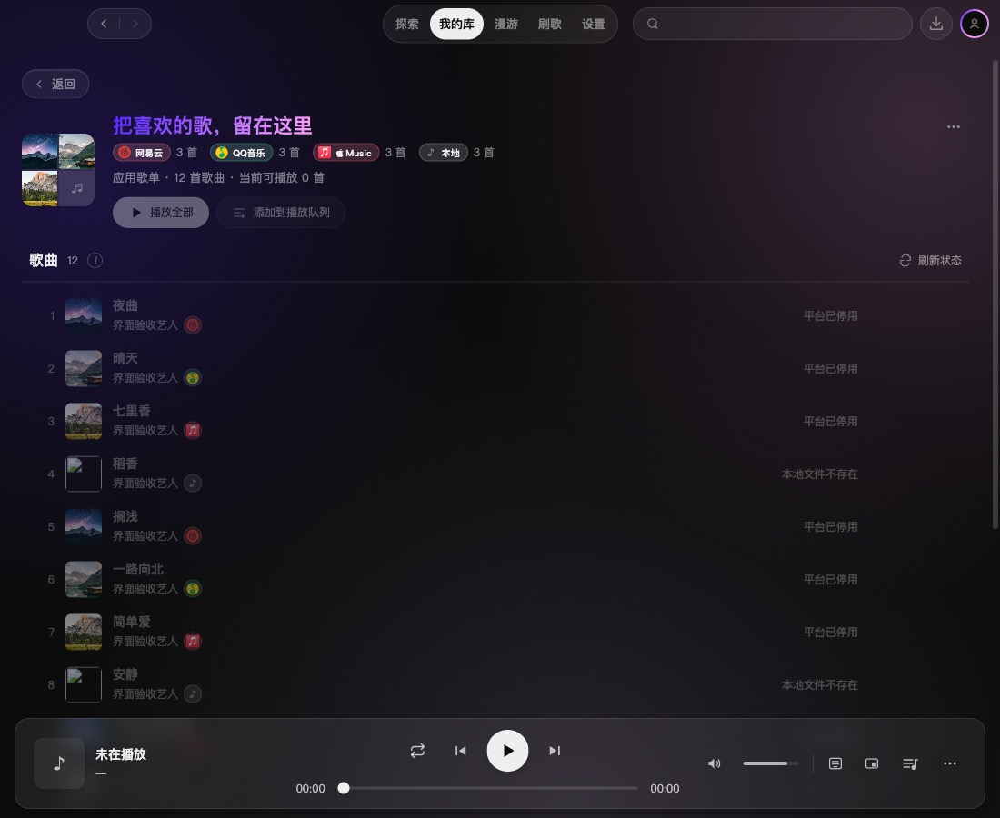

# 2.4.0 应用歌单复用平台歌单样式

应用歌单列表复用我的库平台分区、网格及 PlaylistCard 的样式，接入相同的 TiltCard、BorderGlow。保留拼图封面和多来源数量；移除重复的常驻介绍，空态仍提供新建指引。

详情复用 PlaylistDetailView 的内边距、80px 封面、标题、返回及刷新样式；更多菜单复用 BatchTrackActions 的圆形触发器和菜单样式。应用歌单的播放、来源、排序、移除、重命名及删除确认保持原有逻辑。

| 页面 | 修改前 | 修改后 |
| --- | --- | --- |
| 列表 |  |  |
| 详情 |  |  |

[浅色列表 960px](assets/2.4.0-app-playlist-shared-style/after-list-light-960.jpg) · [最小窗口长名称](assets/2.4.0-app-playlist-shared-style/after-detail-long-minimum.jpg)

验证：

- `npm run typecheck` 通过；`npm test` 277 文件、2601 用例通过；`git diff --check` 通过。
- `npm run dev` 使用 /tmp 独立配置启动真实 macOS Electron，通过 CDP 检查深浅主题、1100×900、960×900、960×540、内容延展、长名称、空列表、空歌单及存档读取错误；未见横向溢出或页面异常。
- 实际点击检查卡片导航、新建、重命名、下移、移出、刷新、删除确认与取消。验证脚本对页面切换动画中的重复节点补充等待；未改动应用转场。
- 独立复核提出的新建按钮未复用胶囊样式、更多按钮受旧选择器影响两项已修复并复核；设计检测器无输出。

截图使用隔离配置中的测试歌单与 Unsplash 示例封面，不修改用户账号或歌单。未验证真实音频播放、云端写入及 Windows；未构建安装包。目标集成分支为 dev/2.4.0，不涉及版本升级或发布。
