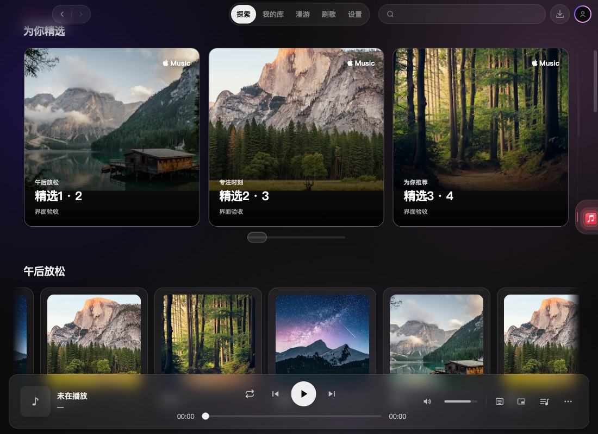
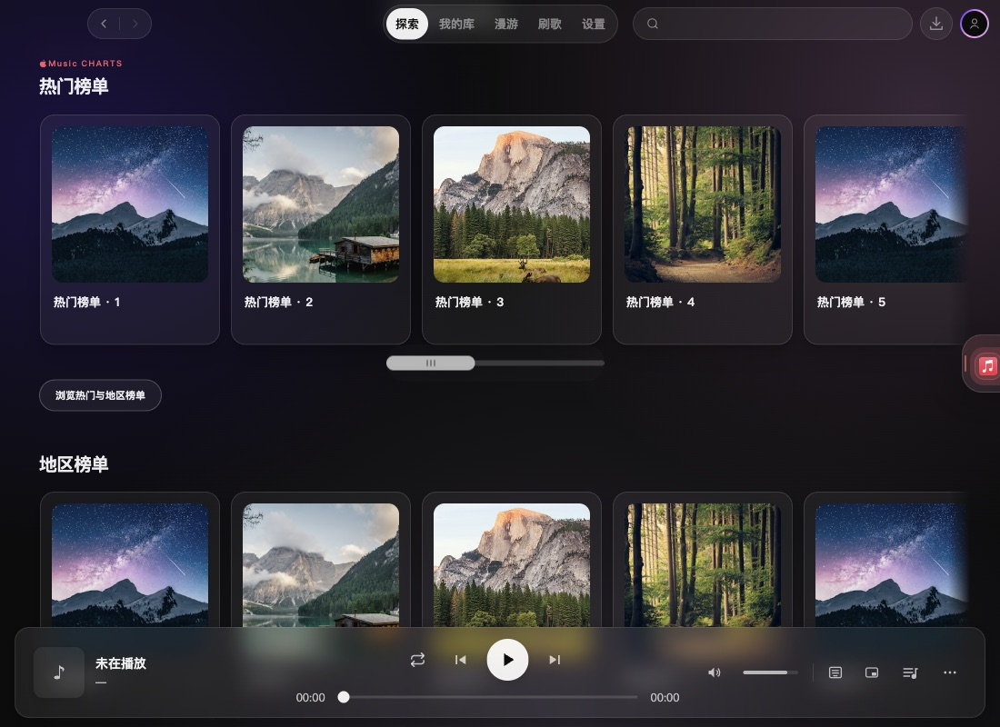
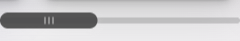

# 2.4.0 探索页横向滚动验收

> 本文包含当时的中央滑块方案与截图，已由[内容底边统一滚动条](2.4.0-rail-integrated-scrollbar.md)替代。当前展示与行为以上述新记录和代码为准。

目标版本与集成分支为 `dev/2.4.0`，工作分支为 `feature/explore-rail-input-2.4.0`。本轮解决横排箭头遮挡内容、纵向滚轮被强制转为横移，以及 Apple Music 榜单浏览方式不一致的问题。

## 修改

- `HorizontalCardRail` 移除左右箭头、翻页逻辑和非 passive 滚轮拦截。普通滚轮在卡片区域仍纵向滚动页面，横向手势继续使用浏览器原生处理。
- 溢出列表统一保留既有底部胶囊拖动条，支持鼠标拖动和原生方向键、Home/End；不溢出时不显示。拖动条使用 `input` 事件即时更新位置，尺寸变化后重新计算范围。
- 横排容器允许获取焦点；未修饰的方向键在捕获与冒泡阶段避让播放快捷键，保留原生滚动；组合快捷键沿用应用规则。
- Apple Music 精选、个性化分组、热门/地区榜单、个人专辑和歌单均使用同一横排。热门与地区榜单由多行网格改为单行横排，保留原数量及全部榜单入口。精选取消自动轮播，改为手动浏览。

## 验证

- `npm run typecheck` 通过；`npm test` 共 274 文件、2561 项测试通过。回归测试先复现普通滚轮被拦截，再验证列表首部、中部、末尾及三种滚轮单位均不被改写；保留边界观察和卸载清理检查。
- 独立复核通过。补齐方向键避让标记，并防止用户自定义普通方向键播放绑定在冒泡阶段抢占横排操作。
- macOS 真实 Electron、独立临时配置，以缓存测试数据提供三平台列表。Apple 六类横排及网易/QQ“你的歌单”均实测纵向滚轮改变页面 `scrollTop`、横排 `scrollLeft` 保持不变；原生横向滚轮输入能横移。
- 实测拖动条鼠标拖拽、Home/End 到达两端、容器原生方向键（含自定义 Right 播放绑定）、960×540 缩放后重新到达末端；仅一张卡片时不显示拖动条。页面无未处理异常，深浅主题及最小窗口未发现页面横向溢出。设计检测无发现。

## 实际页面

[Apple 浅色榜单](assets/2.4.0-explore-rail-input/apple-charts-light.jpg) · [最小窗口与键盘焦点](assets/2.4.0-explore-rail-input/apple-charts-minimum.jpg) · [地区榜单](assets/2.4.0-explore-rail-input/apple-storefront-dark.jpg) · [网易横排](assets/2.4.0-explore-rail-input/netease-rail-dark.jpg) · [QQ 横排](assets/2.4.0-explore-rail-input/qq-rail-dark.jpg)。

截图来自实际 React 界面，CDP 设置逻辑视口，不含原生边框。测试歌单、风景封面和模拟登录仅用于交互验收；未验证真实平台推荐内容、Windows 实机鼠标或触屏。未更改版本号、打包或发布。

[结构化交互记录](2.4.0-explore-rail-input-verification.json)。

## 拖动条精修补充

针对固定小滑块和矩形焦点框，后续阶段 `feature/rail-control-polish-2.4.0` 精修了共用控件：滑块长度按可见内容比例变化，至少 44px，始终保留拖动行程；热区扩大至 40px 高。三线握柄、主题自适应的轨道、悬停提亮、按下增厚与圆角键盘焦点提供明确反馈。拖动时立即同步受控值，握柄按真实滑块行程定位，不使用追赶指针的缓动。

| 状态 | 深色 | 浅色 |
|---|---|---|
| 静止 |  |  |
| 悬停 |  |  |
| 键盘焦点 |  |  |

实际 Electron 验证了轨道点击、连续拖动、拖出热区后松手、Home/End、960×540 缩放后的末端定位、握柄与滑块的几何对齐，以及较短列表使用更长滑块。普通纵向滚轮、原生横向手势及减少动态效果继续有效。类型检查、274 文件/2561 项全量测试、独立复核通过，设计检测无发现。

[精修交互记录](2.4.0-rail-control-polish-verification.json) · [最小窗口焦点状态](assets/2.4.0-explore-rail-input/polish-minimum-focus-dark.jpg)。截图和交互采用 macOS Electron 与隔离测试数据，未做 Windows 或实体触屏验证。
