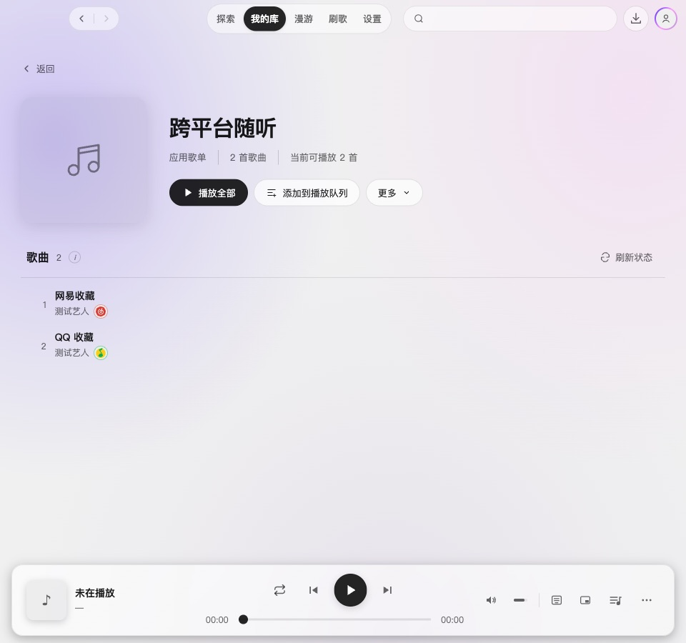

# 2.4.0 歌单职责收敛验收

应用歌单仅承担跨来源聚合、整理与播放；平台“歌单”承担直接管理。新建入口在平台列表，归属核验通过后详情提供改名与多选移出，同源批量菜单提供加入已有平台歌单或新建并加入。取消应用歌单检查、拉取、推送、冲突合并的完整运行时与接口；历史方案保留并注明失效。

## 结果与范围

- 网易云、QQ 可创建空私密歌单、改名、增量加入和移除选中歌曲。QQ 限本人私密普通歌单，Apple 只读。服务端重新验证归属和当前账号，不以清单位置或作者显示名授权。
- 应用收藏保留四种来源、顺序和漫游信息，忽略旧同步关联；读取不写盘，正常保存不再携带关联。没有删除远端歌单或本地音频。
- QQ 红心已迁移到通用写入会话，原漫游兼容读取能力保留。应用歌单美化保留，移除同步区域后曲目列表直接衔接标题。
- 写入只处理显式增量，创建未知结果保留有界检查点；不全量覆盖、不自动匹配、不重放未知创建。未知和部分结果分别提示。
- 缓存失效保留挂载页快照，写入遇到刷新会补读；部分移出的回执由详情持有，不随选区缩小消失。

## 实际界面

[平台歌单列表](assets/2.4.0-playlist-boundaries/platform-library-dark.jpg) · [网易新建](assets/2.4.0-playlist-boundaries/create-netease-dark.jpg) · [新建后的空歌单](assets/2.4.0-playlist-boundaries/new-empty-playlist-dark.jpg) · [加入平台歌单](assets/2.4.0-playlist-boundaries/add-platform-picker-dark.jpg) · [部分移除回执](assets/2.4.0-playlist-boundaries/partial-remove-dark.jpg) · [QQ 浅色新建](assets/2.4.0-playlist-boundaries/create-qq-light-960.jpg)。

[最小窗口 960×540](assets/2.4.0-playlist-boundaries/aggregate-playlist-minimum.jpg)。截图来自 macOS 的真实 Electron 渲染器，CDP 设置逻辑视口，不包含原生窗口边框；采用独立临时用户配置、模拟 API 响应和测试曲目。

## 验证

- `npm run typecheck` 通过；`npm test` 共 270 文件、2537 项测试通过。
- 真实 `npm run dev` 交互通过：网易新建并进入空歌单、改名刷新标题、缺少 type 字段的真实清单形态仍能管理、同源加入、partial/unknown 移除回执在真实 lazy/selection hooks 与延迟刷新之后保留、QQ 私密创建范围、公开 QQ 歌单只读、混源应用收藏无同步、最小视口无横向溢出。
- 服务端测试涵盖归属、跨来源、换号/取消、批次部分失败、创建结果未知与同账号重新登录后的幂等、QQ 身份与元数据保护。
- 独立服务端及渲染层复核通过。修正了创建标识与账号绑定、刷新并发和移出回执生命周期问题，并补回归用例。
- 设计检测仅有原详情返回箭头弹性缓动的一条既有建议项，未改动该效果。无新增检测问题。

本轮没有向真实音乐平台发出歌单写入，没有真实音频播放或 Windows 实机验收；新接口真实账号写通道需后续人工验证。功能验证使用模拟 API，不能据此宣称已完成真实平台端到端验收。未构建安装包、更新版本或发布。

[产品范围与实施方案](../specs/2026-10-18-playlist-boundaries.md) · [结构化界面验证](2.4.0-playlist-boundaries-verification.json)。
