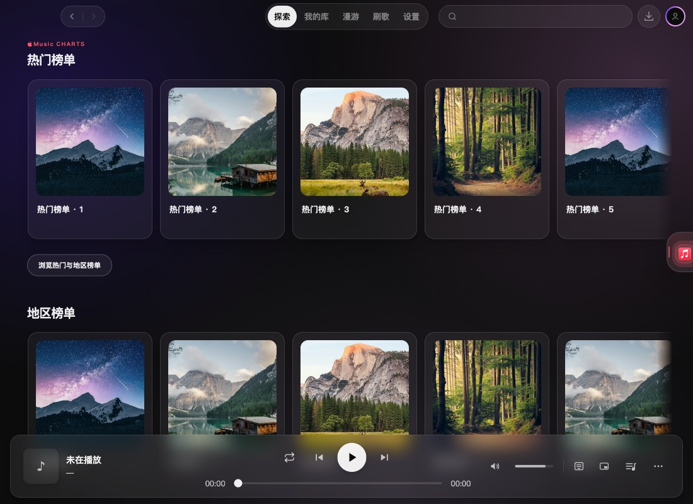
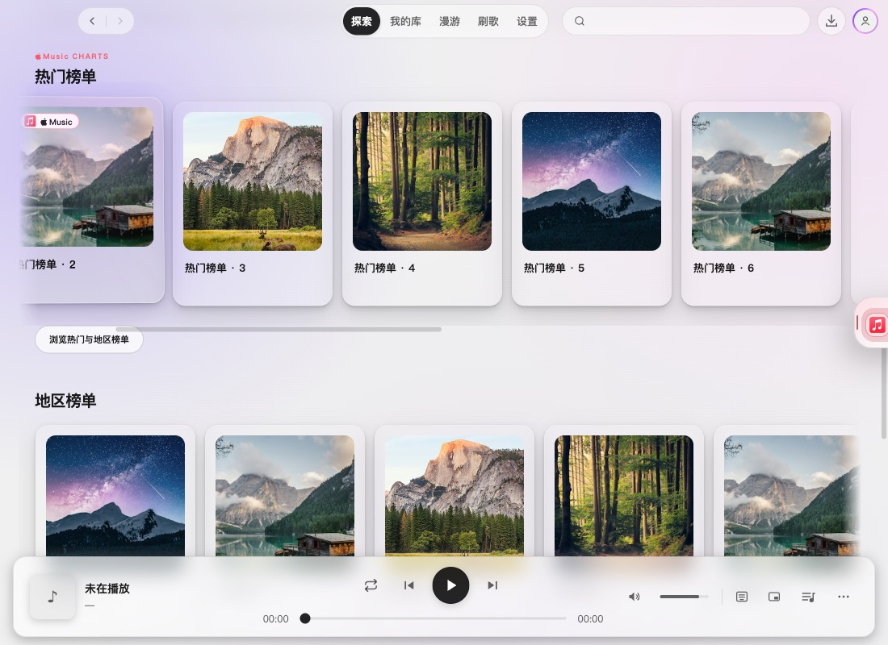

# 2.4.0 横排与整体风格验收

所属版本为 2.4.0，目标分支为 `dev/2.4.0`。上一版中央亮色胶囊、抓握纹理和独立焦点框与应用整体不协调，本轮改为沿内容底边布局的统一滚动条。

## 最终表现

- 去掉中央滑块、纹理、按压放大及独立面板；音乐封面和栏目留白保持视觉中心。
- 原生横向滚动条复用应用现有 `--sm-scrollbar-*`：透明轨道，低对比度圆角滑块，悬停/按下逐级加深；停止滚动且鼠标离开 800ms 后收起，键盘聚焦时保持可见。
- 滑块比例与拖动由浏览器维护，不再为滚动位置逐帧更新 React state。底部留白缩小，滚动条左右与内容对齐。
- 保留鼠标拖动、横向手势、纵向滚轮滚页及键盘方向键；Home/End 在横排本身聚焦时定位首尾。Apple Music 各横排共用同一表现。

## 实际页面

[深色悬停](assets/2.4.0-rail-integrated-scrollbar/hover-dark.jpg) · [浅色静止](assets/2.4.0-rail-integrated-scrollbar/idle-light.jpg) · [拖动到末端](assets/2.4.0-rail-integrated-scrollbar/dragged-dark.jpg) · [960×540 最小窗口](assets/2.4.0-rail-integrated-scrollbar/minimum-dark.jpg)。

## 验证

- `npm run typecheck`、274 文件/2561 项全量测试通过，独立复核通过，设计检测无发现。
- macOS 真实 Electron 中，直接拖动浏览器滚动条到达末端；方向键、Home/End、窄窗口、深浅主题、滚动后显隐均通过。滚动条 10px 热区与 21px 轨道边距已核对。
- 普通纵向滚轮只改变页面位置，横排位置保持不变；原生横向手势正常。移除独立 range 与翻页按钮，保留观察器更新边缘渐隐及卸载清理。
- 页内边缘渐隐不会遮蔽滚动条；键盘聚焦保持明确反馈。无页面异常。

使用独立临时配置、模拟登录和缓存测试歌单；未验证 Windows 或实体触屏，也未调用真实云端音频、修改平台歌单。未更改版本号、构建安装包或发布。

[结构化交互记录](2.4.0-rail-integrated-scrollbar-verification.json)。
