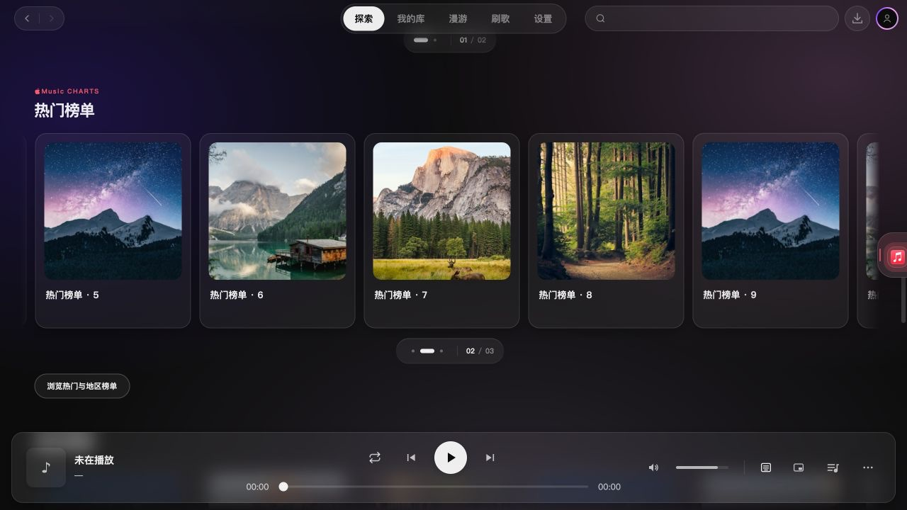
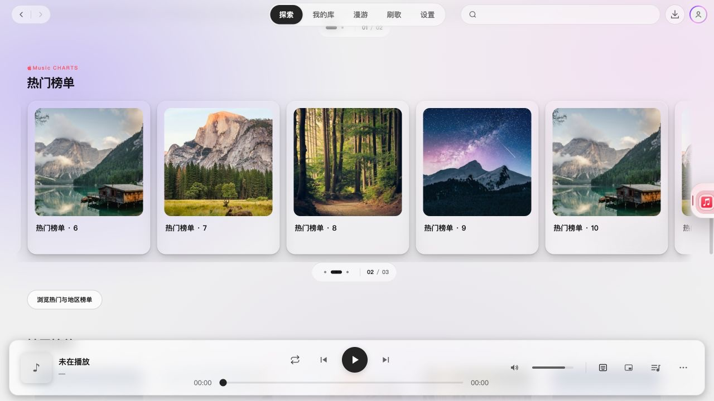
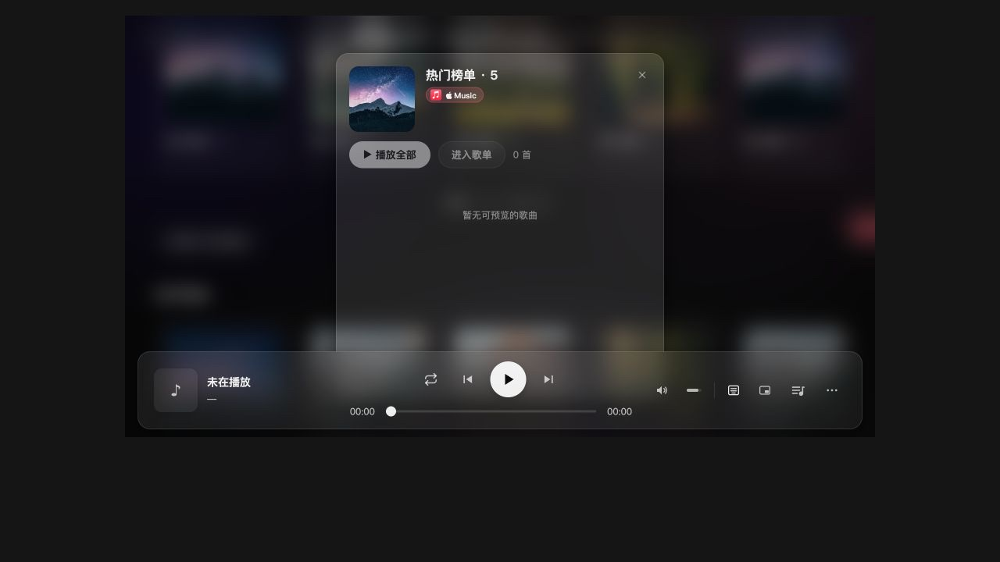

# 2.4.0 横排拖动与分段导航验收

所属版本：2.4.0；目标分支：`dev/2.4.0`。替代上一版原生横向滚动条。参考 Apple 画廊的位置提示，保留应用自己的字体、深浅主题和玻璃表面。

## 行为与展示

- 鼠标可直接抓取卡片横拖，松手后以有限惯性停齐封面；拖动阈值与点击分开，拖后不误开歌单。触控保持浏览器原生处理。
- 溢出时展示小型分段导航和当前组/总组数，支持点选、拖动、方向键与 Home/End。标记最多 9 个，大量组使用压缩刻度和真实组数；未溢出时不展示导航。
- 当前短线随内容位置移动，尾组不足一屏仍与刻度一致。表面内高光、轻阴影、悬停与按压反馈复用现有主题；不添加常驻光效、自动轮播或 3D 特效。
- 普通纵向滚轮不转为横滚，原生横向手势保留；新输入可取消惯性。系统减少动态时直接停靠并取消动量。
- 网易云、QQ 的账号歌单与 Apple Music 的主推、推荐组、榜单、专辑和账号歌单共用该组件。

## 验证与边界

- `npm run typecheck` 通过；全量 275 个测试文件、2568 项测试通过；横排定向 11 项通过。
- 新用例覆盖分组/尺寸变化、普通点击、小幅移动、横拖误触、触控/右键/纵向意图、外部松手、惯性中断、取消/卸载清理及尾组刻度。
- 独立只读复核发现并修复尾组刻度不一致、外部松手后悬空拖动两个问题；补充回归后复核通过。
- `npm run dev` 启动隔离开发配置。页面交互验收在 macOS 的 Chromium 浏览器中运行真实 App/探索页源码，使用模拟登录和缓存歌单；960×540 使用同源 iframe 的真实子视口。浏览器截图不是原生 Electron 窗框截图。
- 实际验证 Apple 横排卡片拖动后不打开详情、导航拖到末组、Home/End、歌单点击进入详情、纵轮滚页与横向输入。纵轮操作前后横排 `scrollLeft=0`，页面从 `2706` 移到 `2850`；横向输入使横排移至 `640`。
- 未验证 Windows、实体触屏或物理触控板手感；没有播放真实云端音频、修改平台歌单、升级版本或发布。

临时测试入口、固定数据和配置均不提交；保留截图作为展示依据。
