# 2.4.0 现有界面精修与前后对照

记录日期：2026-10-15。修改基线：`dev/2.4.0` 的 `5503e2b`。本次保留顶部导航、页面布局、玻璃材质、主题配色、系统字体及底部播放条，在现有界面内精简信息、调整操作层级并补齐键盘入口。

## 阅读方式与截图条件

下方每组左侧为修改前，右侧为修改后，可打开图片查看原尺寸。第 1–7 节原始对照除刷歌外，截图来自真实 macOS Electron 完整应用：逻辑窗口 **1100×900**、深色主题，原始 JPEG 截图 **2200×1800**。第 5.1 节后续修复采用浏览器截图，条件单独注明。截图没有裁切、拼接或重新绘制。

为重现相同内容，临时验收模块为推荐卡片、应用歌单详情和刷歌提供测试数据；使用独立用户配置，没有读取或修改日常账号。首页榜单来自公开接口，推荐卡片无封面时显示应用现有回退样式。应用歌单列表与离线音乐使用空状态。背景采用应用已有的静态背景选项，方便对照；鼠标位置、动态来源徽标和牌堆随机角度可能不同，图片用于人工核对而非逐像素回归。

补充的浅色截图使用 **960×900** 逻辑窗口。另用正常开发配置、全新用户配置、未注入测试模块的应用确认漫游设置入口；详见文末验证范围及[验证记录](2.4.0-ui-refinement-verification.json)。

## 1. 首页：收紧标题，保留原有推荐布局

保留渐变问候、英文装饰标题和推荐牌堆。问候字号上限从 48px 调至 38px；顶部间距从 30px 调至 24px；英文装饰降低字重、字距和强调，让推荐内容更早进入视线。卡片、平台标识与播放条的位置体系不变。

| 修改前 | 修改后 |
|---|---|
| 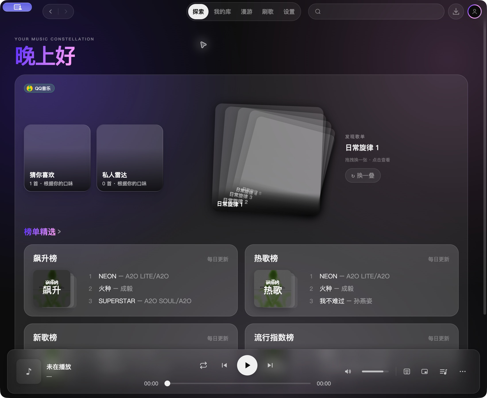 | 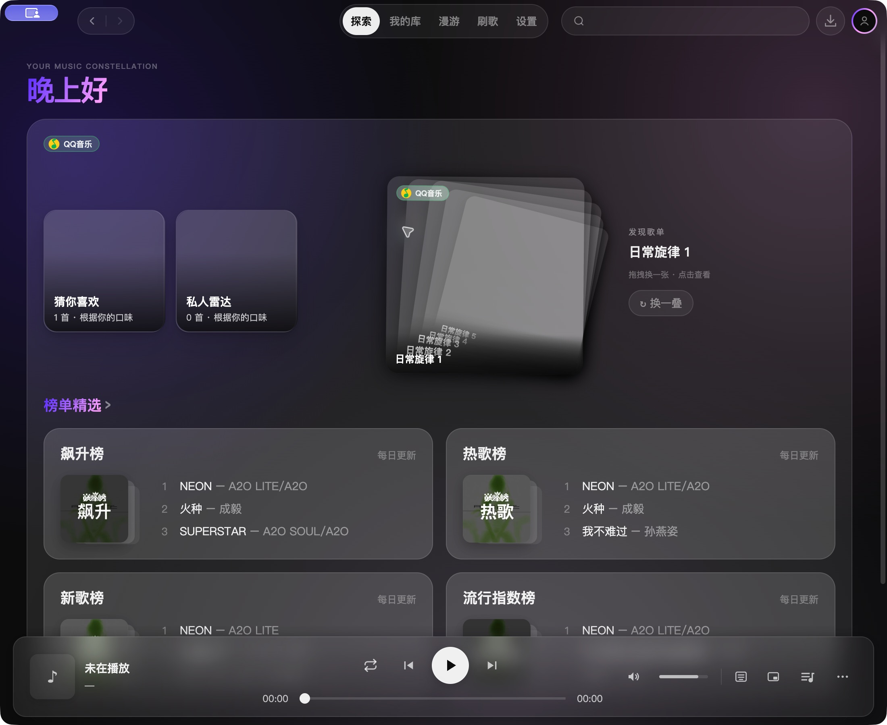 |

无平台首页也保留原有登录条件与设置按钮：[修改前](assets/2.4.0-ui-refinement/before-explore-empty.jpg) · [修改后](assets/2.4.0-ui-refinement/after-explore-empty.jpg)。

代码：[ExplorePage 样式](../../src/pages/ExplorePage.module.css)。

## 2. 应用歌单列表：去掉重复介绍

“把喜欢的歌，放在一起”及跨平台介绍收敛为分类名“应用歌单”；卡片曲目数后不再重复标注“应用歌单”。保留“新建歌单”、空状态的下一步，以及读取失败后的重试入口。

| 修改前 | 修改后 |
|---|---|
| 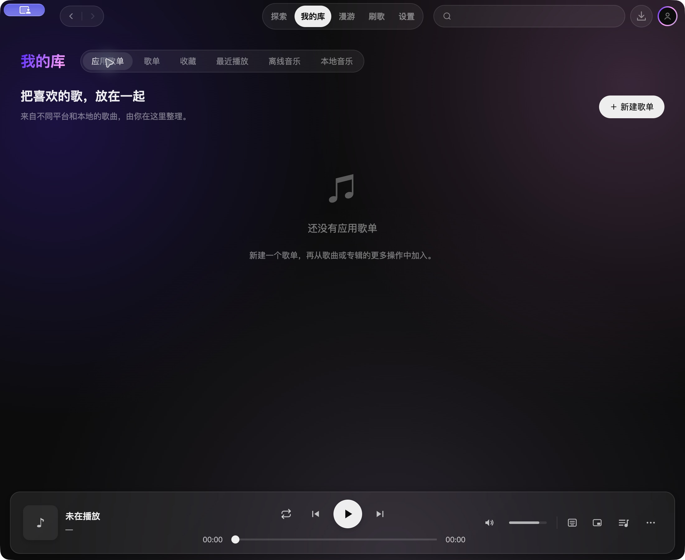 | 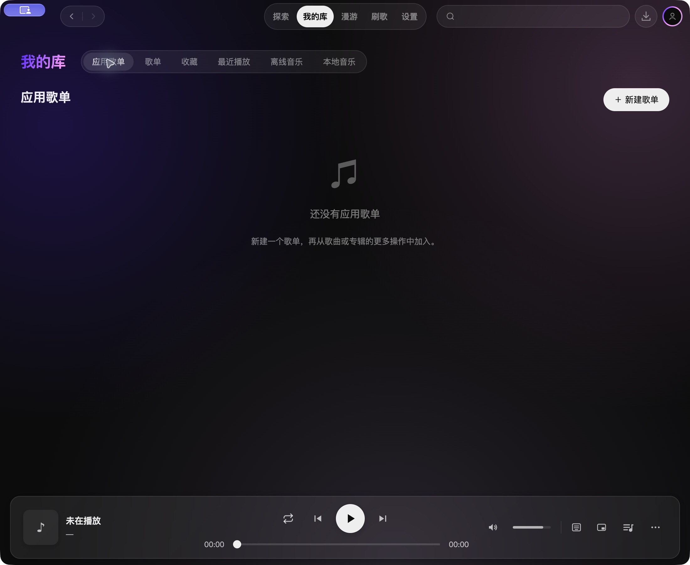 |

此对照为列表空状态；有歌单时卡片说明的精简以源码为准，没有将空态截图表述为已覆盖卡片列表。

代码：[AppPlaylistsTab](../../src/pages/AppPlaylistsTab.tsx)。

## 3. 歌单详情：播放在前，管理收进“更多”

保留“播放全部”主操作和“添加到播放队列”；“重命名”“删除歌单”收进同一区域的“更多”，删除使用现有危险色。排序说明移到帮助入口，刷新、单曲上移/下移及移出歌单继续保留。删除仍需确认，并明确当前播放队列和歌曲文件会保留。

| 修改前 | 修改后 |
|---|---|
| 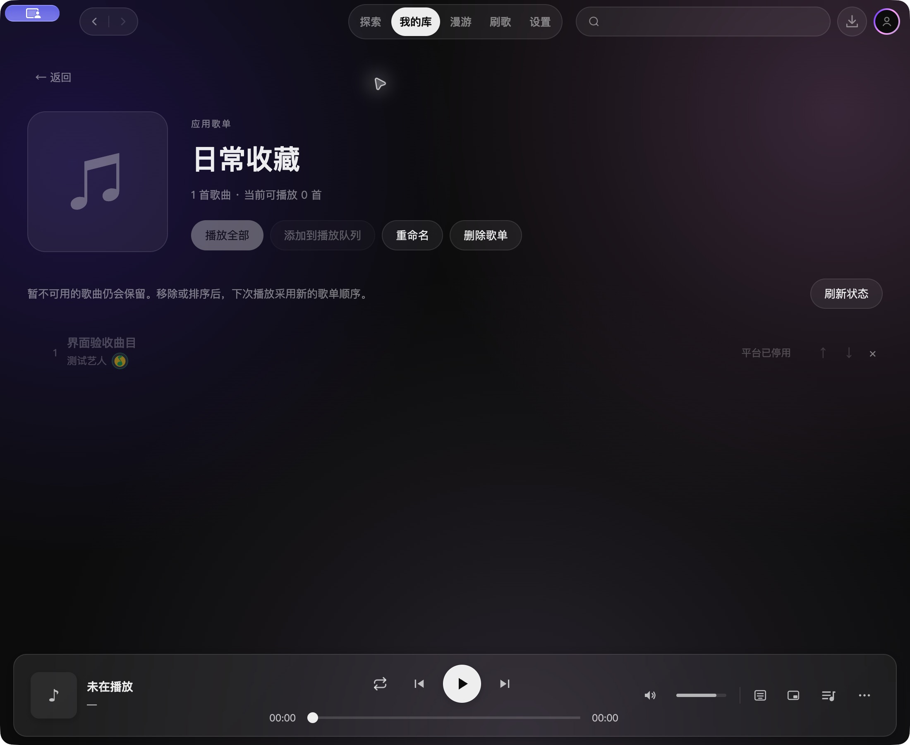 | 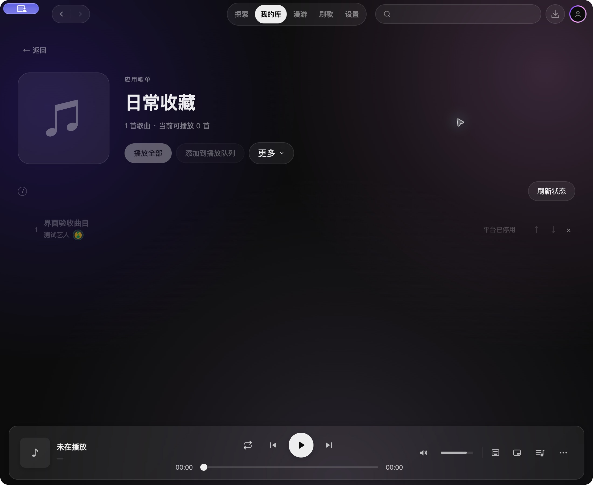 |

截图中的曲目属于停用平台，因此播放按钮按原有规则禁用。菜单采用原生展开控件；Enter 展开，按应用原有键盘策略使用 Option+Tab 在 macOS 遍历控件，Escape 收起。取消或关闭重命名、删除弹窗后，焦点回到“更多”。

| 管理操作展开 | 浅色 960px 下的删除确认 |
|---|---|
| 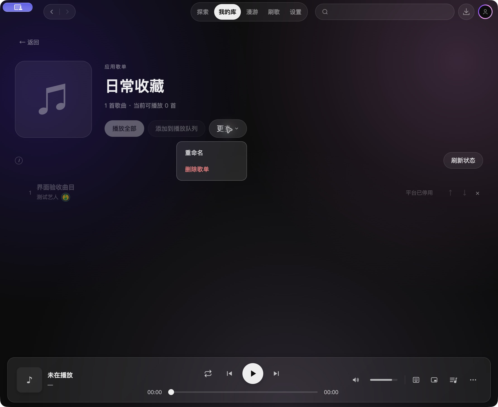 | 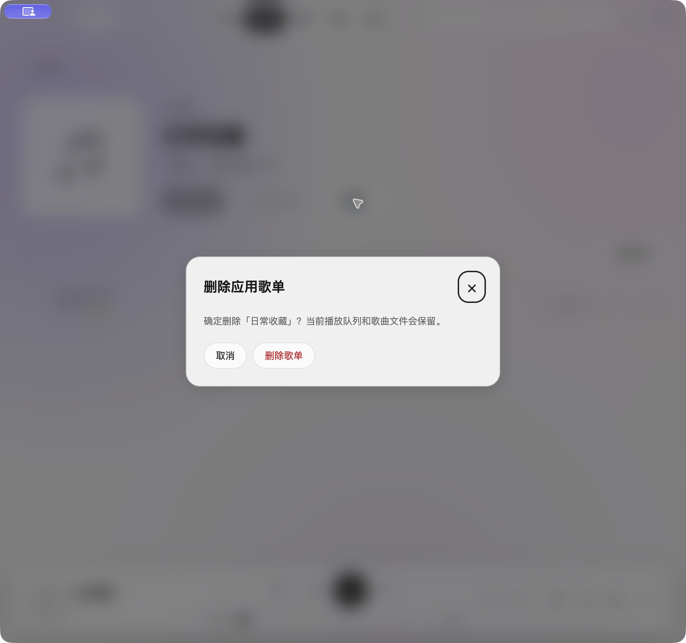 |

代码：[AppPlaylistPage](../../src/pages/AppPlaylistPage.tsx)、[局部样式](../../src/pages/AppPlaylists.module.css)。

## 4. 离线音乐：浏览区保留一句必要说明

浏览时仅常驻“已保存歌曲无需登录即可播放”。移除保存与批量删除的区别放到相邻帮助入口；单曲移除按钮的提示仍说明音频会保留为临时缓存。批量删除的确认文案及下载目录文件保留边界没有删除。

| 修改前 | 修改后 |
|---|---|
| 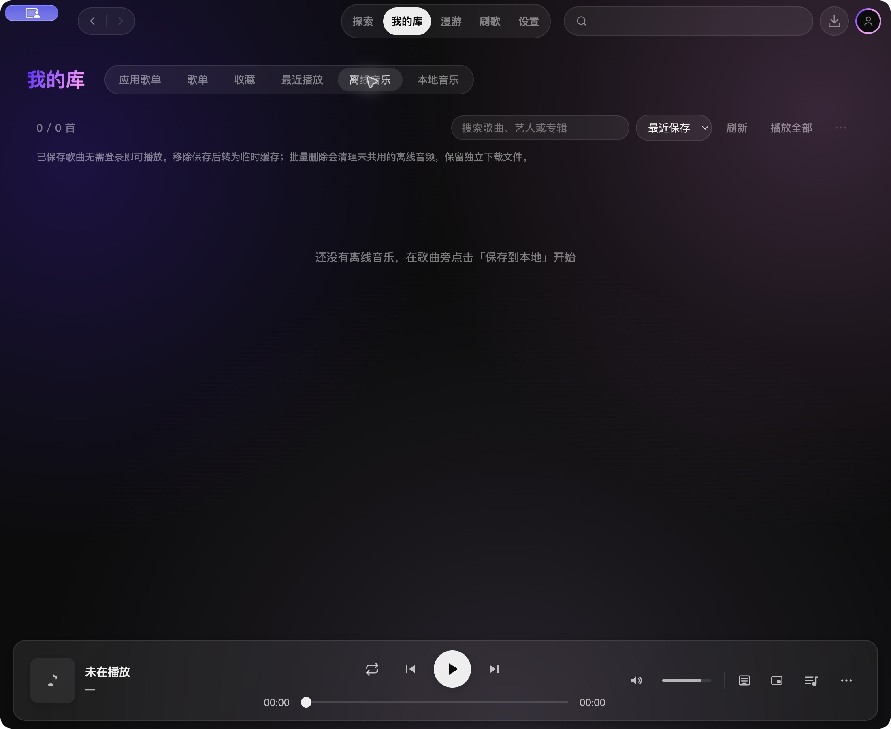 | 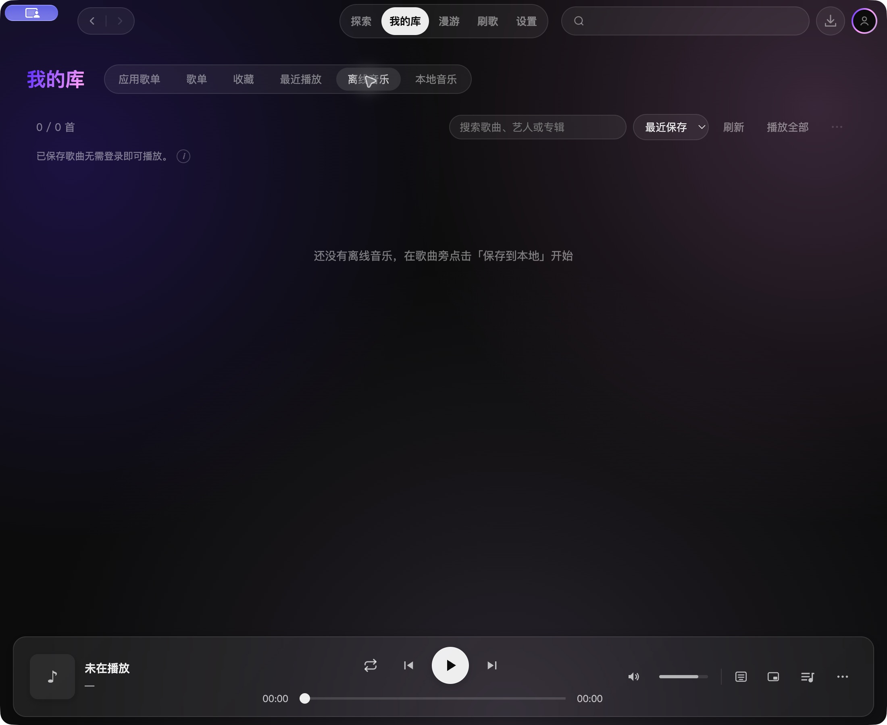 |

[展开后的完整说明](assets/2.4.0-ui-refinement/after-offline-help.jpg) · [浅色 960px 说明](assets/2.4.0-ui-refinement/after-offline-help-light-960.jpg)。本次使用空离线库，没有执行真实移除或批量删除。

代码：[OfflineMusicTab](../../src/pages/OfflineMusicTab.tsx)。

## 5. 漫游：先做选择，需要时再看同步条件

首屏介绍精简为“选择喜欢的歌手，生成你的漫游歌单”。原有平台参与、保存位置及网易云同步条件放入“保存与同步说明”；初版原地展开会撑高卡片，现已按第 5.1 节修正。未启用平台时，原来的禁用按钮改为可点击的“打开音源设置”，直接进入音源与播放设置。

| 修改前 | 修改后 |
|---|---|
| 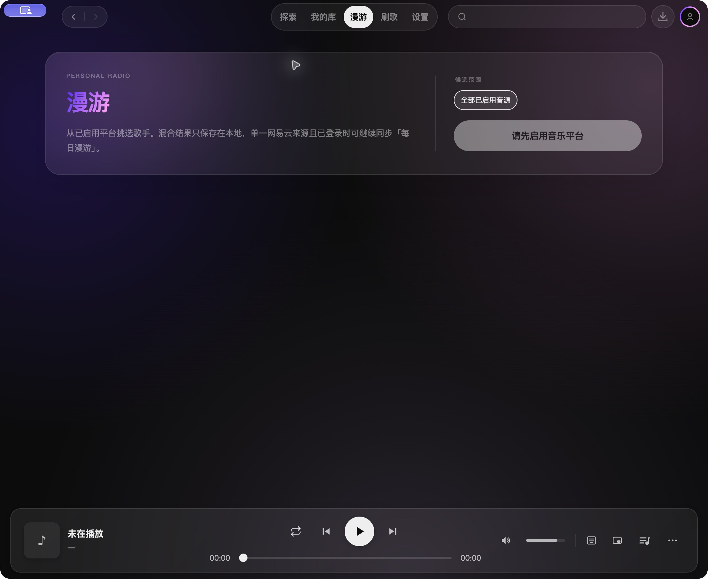 | 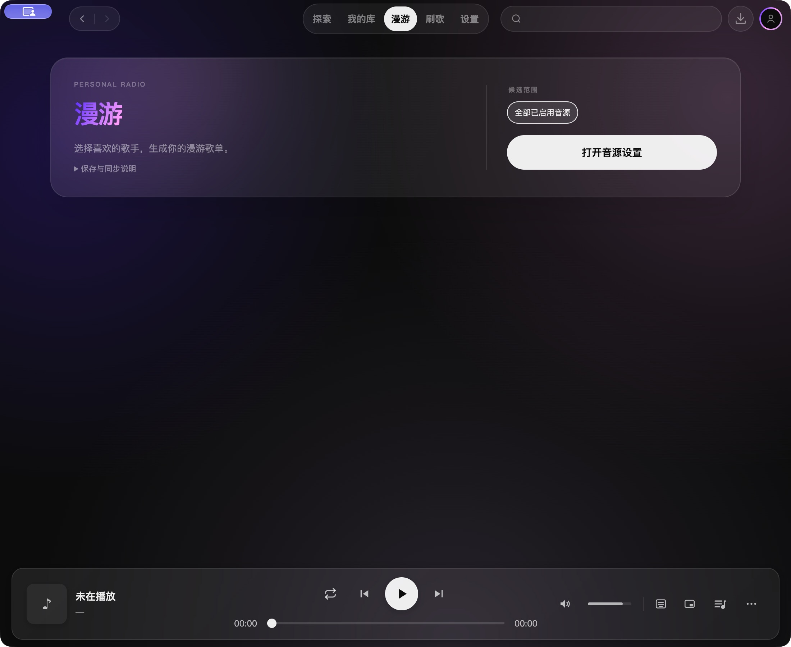 |

[展开完整说明](assets/2.4.0-ui-refinement/after-roam-help.jpg) · [浅色 960px 展开说明](assets/2.4.0-ui-refinement/after-roam-help-light-960.jpg) · [正常配置、无测试模块的实际页面](assets/2.4.0-ui-refinement/after-roam-clean-960.jpg)。

代码：[RoamPage](../../src/pages/RoamPage.tsx)。

### 5.1 后续修复：展开说明时保持卡片稳定

用户反馈初版展开、收起时整个卡片上下变化。本次基于 `aca72ef` 修复：入口位置与文案保留，正文改成独立浮层，不参与卡片高度计算，也不受卡片圆角裁切。再次点击、点击外部、移出焦点或按 Escape 可收起，Escape 后焦点回到入口。

| 修复前展开：卡片增高、右侧操作下移 | 修复后展开：卡片与操作保持原位 |
|---|---|
| 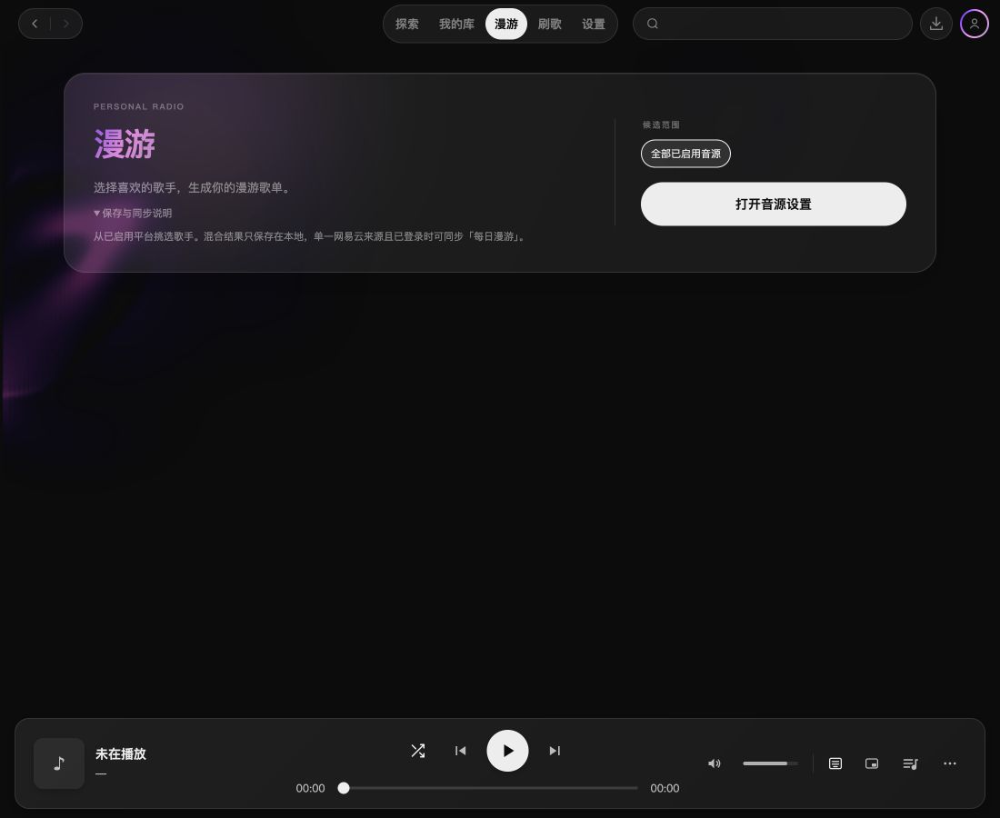 | 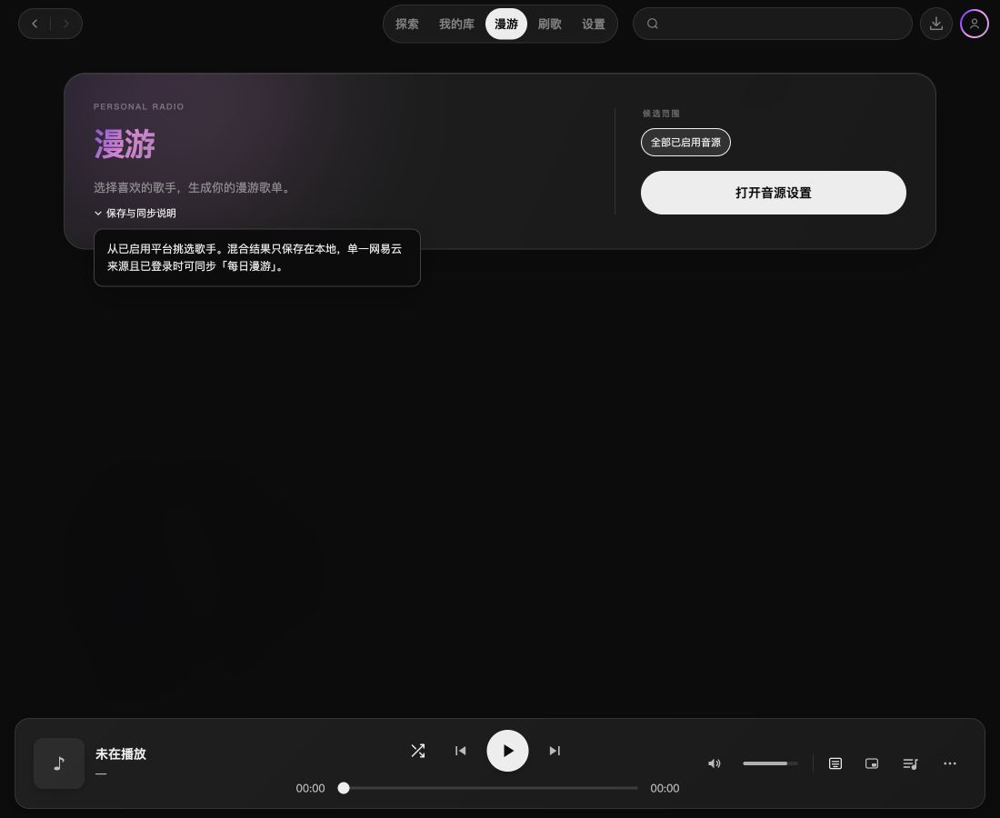 |

[修复前收起](assets/2.4.0-ui-refinement/roam-stability-before-closed.jpg) · [修复后收起](assets/2.4.0-ui-refinement/roam-stability-after-closed.jpg) · [浅色 960px 展开](assets/2.4.0-ui-refinement/roam-stability-after-open-light-960.jpg) · [浅色 740px 单列展开](assets/2.4.0-ui-refinement/roam-stability-after-open-light-740.jpg)。

本组为实际 App 的浏览器渲染截图，默认深色 1100×900，其他尺寸见链接；未裁切或绘制。临时模块仅提供独立验收配置与主题切换，漫游为空状态；未登录账号。本次原生窗口绑定不可用，因此不声称完成原生窗口或 Windows 验收。

浏览器布局回归检查：旧代码展开时卡片高度增加 **25.59px**，右侧操作下移 **12.80px**；修复后深色 1100×900、浅色 960×900 与 740×700 的展开/收起矩形完全一致，位移 **0px**。Enter、Escape、外部点击、键盘移焦已检查；类型检查及全量 257 文件 / 2244 项测试通过，独立代码复核无 P1/P2。[尺寸、交互与截图校验记录](2.4.0-roam-help-verification.json)。

代码：[RoamSaveHelp](../../src/components/Roam/RoamSaveHelp.tsx)。

## 6. 刷歌：减少重复术语，保留播放状态

原来同时出现的“重复段精选/歌曲结构精选”和“副歌候选/精彩片段”合并成一处“精彩片段”；无下一行歌词时，不再显示“喜欢的话，可以收藏或播放全曲”这句重复提示。仍保留定位、缓冲、自动下一首时间、播完停止状态，以及播放全曲和退出入口。

| 修改前 | 修改后 |
|---|---|
| 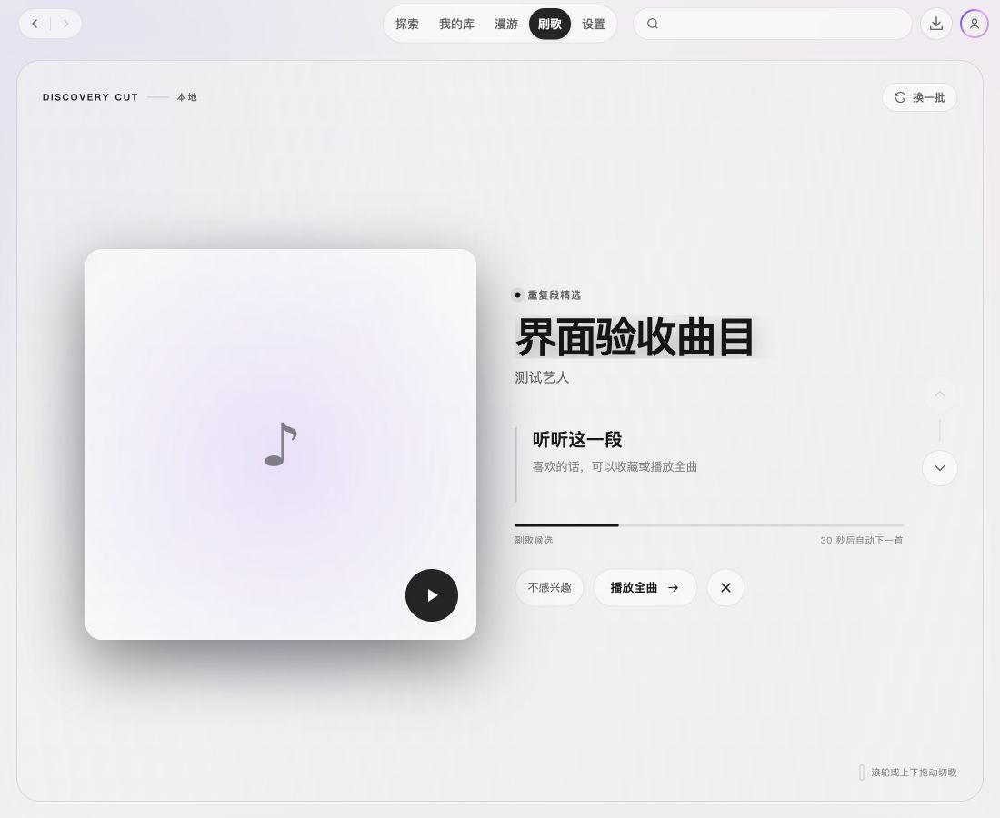 |  |

此组为暂停、无歌词的本地测试曲目，进度及片段状态固定。原生修改前归档误拍错误状态后，补拍时 Mac 已锁屏，因此本组采用实际 App 的浏览器截图：同为浅色主题、1100×900；修改前载入 `5503e2b` 的 `ShuangeCard` 源码及样式，修改后载入当前组件。没有重新设计或绘制页面，也不把这组图表述为原生窗口或真实播放验收。[原生深色 1100px](assets/2.4.0-ui-refinement/after-shuange.jpg) · [原生浅色 960px](assets/2.4.0-ui-refinement/after-shuange-light-960.jpg)。

代码：[ShuangeCard](../../src/components/Shuange/ShuangeCard.tsx)。

## 7. 推荐牌堆：补齐键盘入口

保持原有牌堆、拖拽阈值和卡片旋转。卡片改为有名称的按钮，只有顶牌进入焦点顺序；聚焦后 Enter 打开预览，显示清晰的焦点轮廓。空格继续遵循应用既有的播放快捷键，不再额外触发打开歌单。

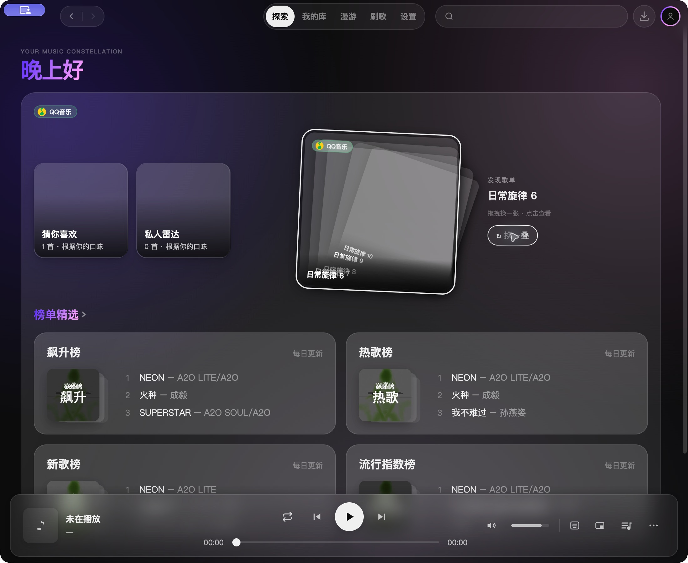

前后整体外观见第 1 组首页截图。实际检查了键盘聚焦、Enter 打开与空格不打开歌单；拖拽算法未改，未单独记录物理拖拽验收。

代码：[Stack](../../src/components/Explore/Stack.tsx)、[回归测试](../../src/components/Explore/Stack.test.tsx)。

## 验证与剩余范围

- 类型检查通过；全量 **257 个测试文件 / 2244 项测试**通过。
- 牌堆键盘入口、无平台漫游入口两个新增回归用例，在旧源码上均失败，在修改后通过。
- 独立复核最终无 P1/P2。复核发现的空格快捷键冲突、漫游帮助裁切和信息按钮样式覆盖已修正；原生检查发现的弹窗关闭后焦点丢失也已修正并复核。
- 真实 Electron 检查了设置跳转、帮助展开、管理菜单、重命名/删除取消与焦点恢复、牌堆 Enter；深色 1100px 和浅色 960px 的可见布局已人工检查。
- 未运行生产构建；未验证 Windows 实机、真实账号登录后的完整内容、真实下载/删除/平台同步。正常退出阶段已有的后台关闭与 macOS 输入法日志单独记录，没有声称运行日志全零。

[完整验证记录与截图尺寸/校验值](2.4.0-ui-refinement-verification.json)。
