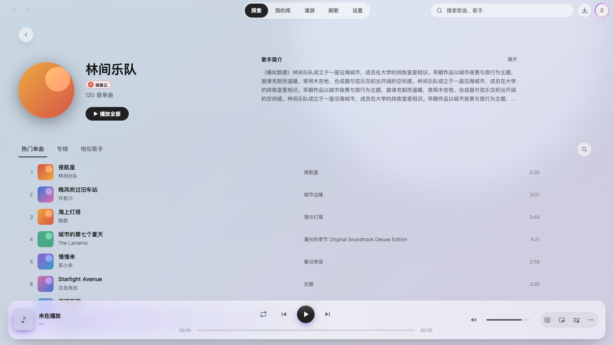
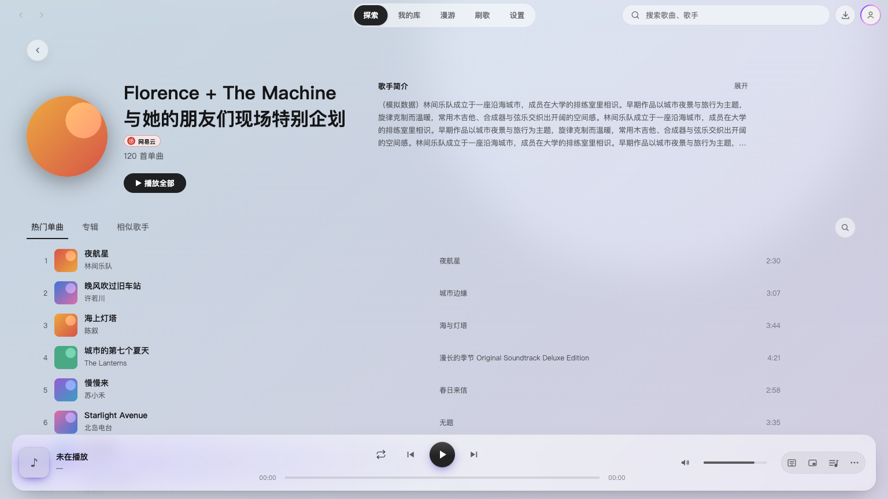

# 歌手简介向中间收回

2026-10-23。上一版把歌手信息按比例放大，简介因此离歌手名太远。现在将左栏限制为最多 560px，简介在相邻列左对齐，最宽仍为 640px；窄窗口上下排列、字号与展开方式保留。

1536px 视口中，简介起点从约 x=850 收回到 x=654。长名字文字列仍有约 392px，比最初仅约 252px 的版本更宽。没有简介时左侧仍可占满内容宽度。

| 调整前 | 调整后 |
| --- | --- |
|  |  |

验证使用真实 React App 与模拟平台数据，无头 Chrome 的 11 个场景通过，包含深浅主题、长短名字、无简介及 960/1024/1025 窗口；展开、内部滚动、收起和播放队列命令仍可用。原生 Electron 也核对了简介 x≈654、宽度 640px，栏目位于资料下方，见 [原生验证](assets/2.4.1-artist-header-balance/native-verification.json)。类型检查及全量 336 个测试文件、3117 项测试通过。未验证 Windows；此前重复导航探针的疑点不在本次改动范围。

[布局验证记录](assets/2.4.1-artist-header-balance/verification.json) · [复验脚本](checks/artist-header-space.cjs)
