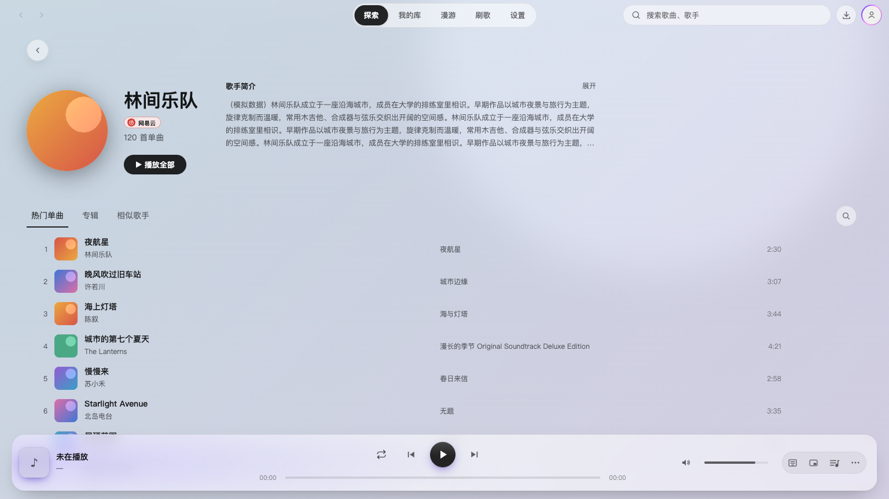
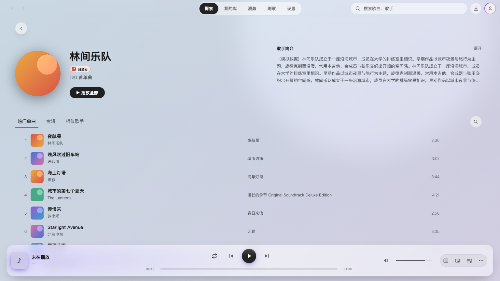
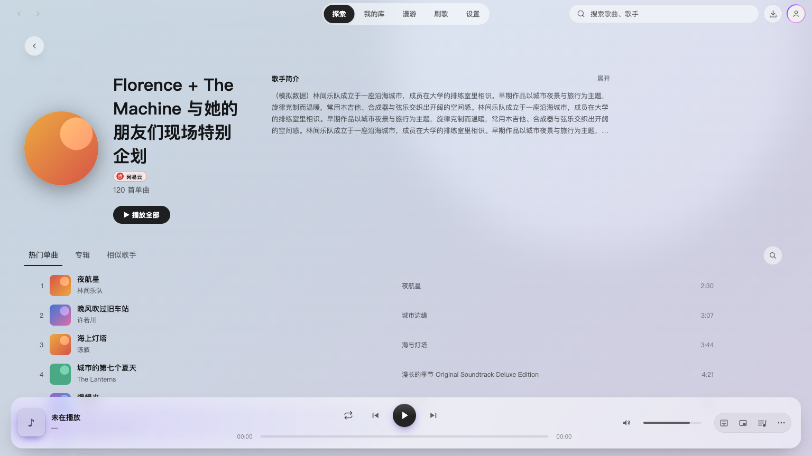
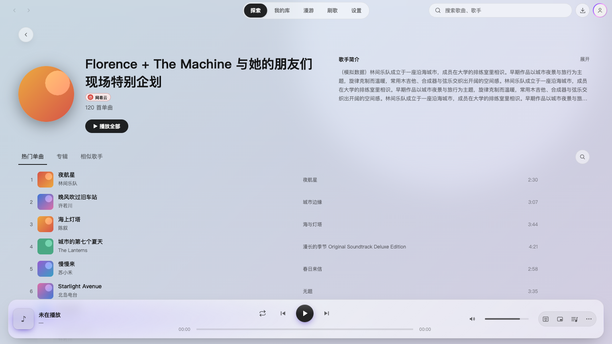
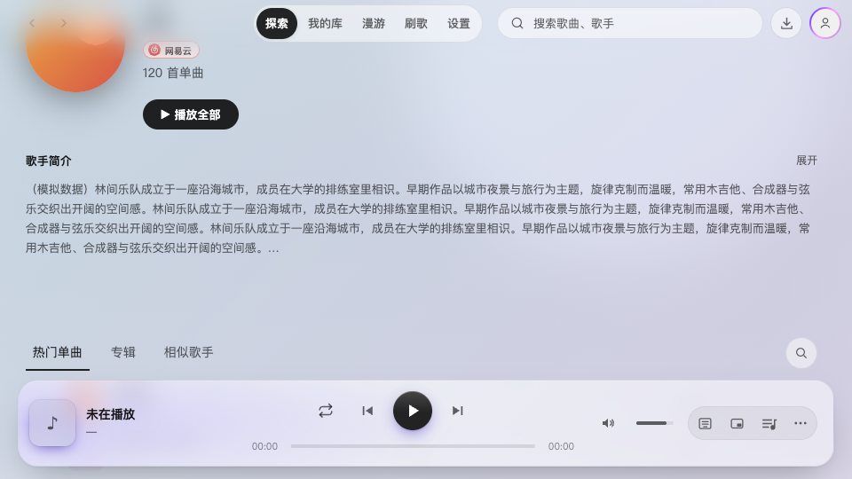

# 歌手页：给歌手名更多空间

2026-10-23，Codex 实施并自检。开发分支 `feature/ui-visual-alignment-2.4.1`，集成目标 `dev/2.4.1`。本文保留提交前的截图与验收记录。本次只修改 `ArtistHeader.module.css`，是在前一轮视觉对齐基础上的追加调整。

宽窗口的左右列按 1.2:1 分配，简介右对齐、最宽 640px；歌手名字号保持 32px。1024px 以下简介排到歌手信息下方。没有简介时，歌手信息仍可占满内容宽度。

## 本轮修改前后

这里的“修改前”是前一轮 feature 的歌手页布局，使用已修正的拍图方式；不是 `dev` 基准。两图使用同样的模拟数据、主题和视口。预览来自真实 React App，平台服务为模拟数据，没有运行音频。

| 本轮修改前 · 浅色 1536×864 | 本轮修改后 |
| --- | --- |
|  |  |

1536px 下，左侧分配宽度由短名字时的 296px 增至约 756px；简介起点由 x=390 移至 x=850。短名字保持自然宽度，不强行拉伸文字。

| 本轮修改前 · 长名字测试 | 本轮修改后 · 同一个测试名字 |
| --- | --- |
|  |  |

长名字测试的实际文字列由 252px 增至约 588px，保留自然换行，不裁切歌手名。测试名字仅用于检验布局。

## 窄窗口

960×540 时上下排列，简介和列表需要向下滚动。滚动后可完整看到简介区域，底部播放器没有妨碍继续阅读。此处选择优先保留歌手名宽度，首屏可见曲目会减少。

## 验证

- [11 个场景记录](assets/2.4.1-artist-header-space/verification.json)：深浅主题、长短名字、无简介、960 最小窗口及 1024/1025 断点通过；名字无横向溢出，首屏栏目始终位于歌手信息下方。
- 大窗口的简介展开、内部滚动、收起，以及“播放全部”的队列命令捕获通过；未播放实际音频。
- 现有 `ArtistHeader.test.tsx` 的 2 项测试通过；布局扫描无发现，`git diff --check` 通过。CSS 小改未构建或重复全量测试。
- 视觉自检覆盖正常、长名字、深色、窄窗口滚动后及无简介等代表截图。
- 本轮使用无头 Chrome 验证真实页面组件，没有进行原生 Electron 或 Windows 整机验收。此前重复导航的滚动探针疑点仍单独保留，本次没有修改导航与吸顶逻辑。

复验：设置 `NODE_PATH` 指向包含 Playwright 的运行时后，执行 `node docs/reviews/checks/artist-header-space.cjs`。脚本创建临时浏览器上下文，启动本地 Vite，结束时关闭二者；`before.module.css` 保存本轮修改前样式用于同数据对照。
