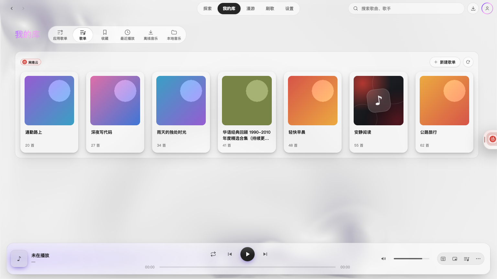
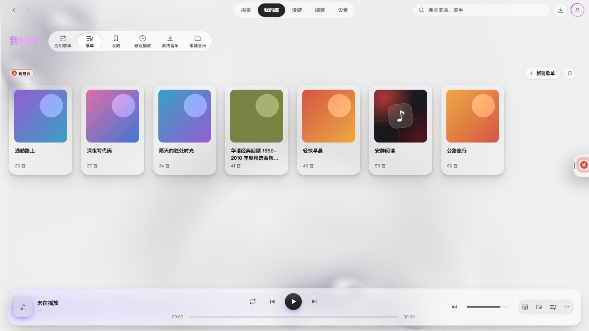

# 库页面恢复遵循页面布局偏好

2026-10-23。修正上一批 UI 改动中无条件移除库外框的问题，目标 `dev/2.4.1`。本次只恢复 `LibraryShelf.module.css` 原有的两套样式，不修改设置页、默认值或持久化逻辑。

- **保留边框**：货架显示边框、圆角、底板及内边距。
- **内容延展**：货架移除外框与底板，内容向两侧展开。
- 音乐库与应用歌单复用同一货架，都服从这个偏好；其他已验收的 UI 优化保留。

原因：前一轮把默认 `.shelf` 外框样式与 `[data-content-layout='full']` 分支同时删掉，覆盖了用户在“界面与窗口 → 页面布局”中的选择。现在该样式文件与 `7a51512` 合入前完全一致。

| 保留边框 | 内容延展 |
| --- | --- |
|  |  |

## 验证

修复前，同一回归脚本在默认“保留边框”下测到 `border=0px`，断言预期 `1px` 失败。修复后，深浅主题 × 1536×864/960×540 共 4 组，逐组通过“保留边框 → 内容延展 → 保留边框”的实际设置按钮切换（12 次状态检查），并核对应用歌单货架同样保留边框。音乐数据为模拟服务。

类型检查与全量 Vitest 336 个文件、3117 项通过，`git diff --check` 通过。原有设置持久化与宿主命令通路测试均包含在全量测试中。隔离的原生 Electron 开发实例也核对了两种布局的实际边框，并保存了 [原生验证记录](assets/2.4.1-library-layout-preference/native-verification.json)。

[回归记录](assets/2.4.1-library-layout-preference/verification.json) · [复验脚本](checks/library-layout-preference.cjs)
