# 2.4.1 非设置页 UI 修改前后对比

日期：2026-10-23。Claude Code 实施，Codex 独立复核。

**库页外框更正：**原有“页面布局”设置已能控制外框，不应全局移除。现已恢复“保留边框／内容延展”两种模式，见 [修复与对照](2.4.1-library-layout-preference.md)。下方去框图片仅保留为前一轮历史方案。

**后续歌手页布局已追加调整：**简介靠右、歌手名获得更多宽度，窄窗口上下排列。最新效果与本轮前后对照见 [歌手页空间调整](2.4.1-artist-header-space.md)。本文件下方 52 组截图保留前一阶段的历史结果。

开发分支：`feature/ui-visual-alignment-2.4.1`；基准：`bd10077c2b8c71d50792e9a0fb8982c111fb1f46`；集成目标：`dev/2.4.1`。修改后截图拍摄于提交前工作树。设置页留待后续重构，本轮未修改其页面和组件源码。

[交互对比文档：切换全部 52 组截图、主题、窗口尺寸及叠图](2.4.1-ui-alignment-comparison.html) · [原图清单](assets/2.4.1-ui-alignment/index.json) · [重放方法](assets/2.4.1-ui-alignment/README.md)

[Codex 验收记录与源码指纹](assets/2.4.1-ui-alignment/review-verification.json)

[合并前全量测试、独立复核与 Electron 冒烟记录](assets/2.4.1-ui-alignment/integration-checks.json)

## 验收结论

本轮视觉对齐改动已复核，原有针对性交互检查通过。后续歌手截图复查另发现重复导航探针的滚动疑点，尚未定因，不能宣称所有滚动路径均验收通过。下列保留项和未覆盖环境仍需单独考虑。

本轮改善的是页面起线、搜索结果密度、文字阅读宽度、歌曲行列距和常规弹层节奏。保留现有字体、音乐内容及整体风格，没有重构设置、歌词或播放引擎。公共顶栏和弹层的样式调整会出现在复用这些组件的页面。

## 1. 搜索：缩短页头，让结果更早出现

删去重复的“聚合搜索”说明，降低标题高度，将分类与来源筛选放在可换行的同一区域。全部结果按歌曲 10 首、歌手 5 位、专辑 6 张、歌单 6 个预览，保留“查看全部”入口。歌曲区域在大窗口明显前移；播放队列仍应使用完整的筛选结果。

| 修改前 · 深色 1536×864 | 修改后 · 相同数据与视口 |
| --- | --- |
| 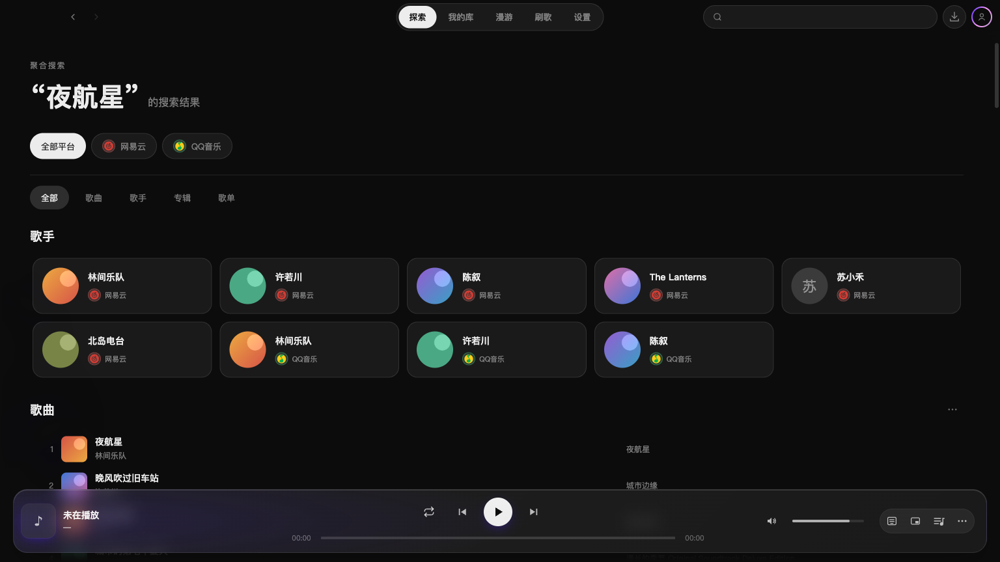 | 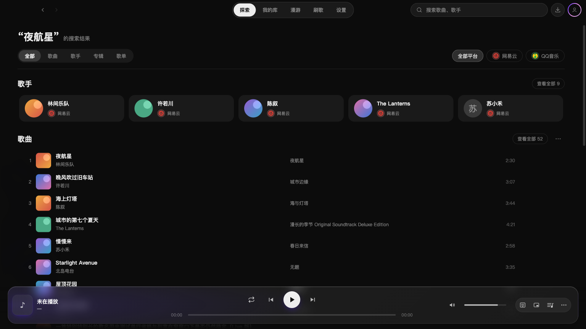 |

**仍保留的问题：**960×540 下，歌手预览仍占两行，歌曲需要向下滚动。此次没有让所有结果都出现在首屏。

| 修改前 · 浅色 960×540 | 修改后 · 相同数据与视口 |
| --- | --- |
| 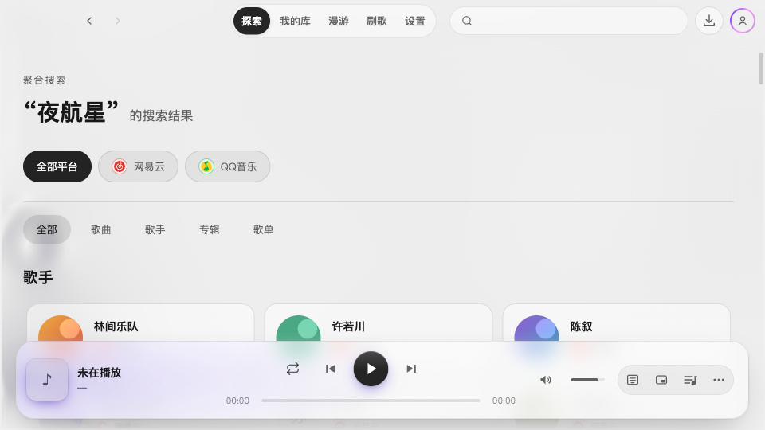 | 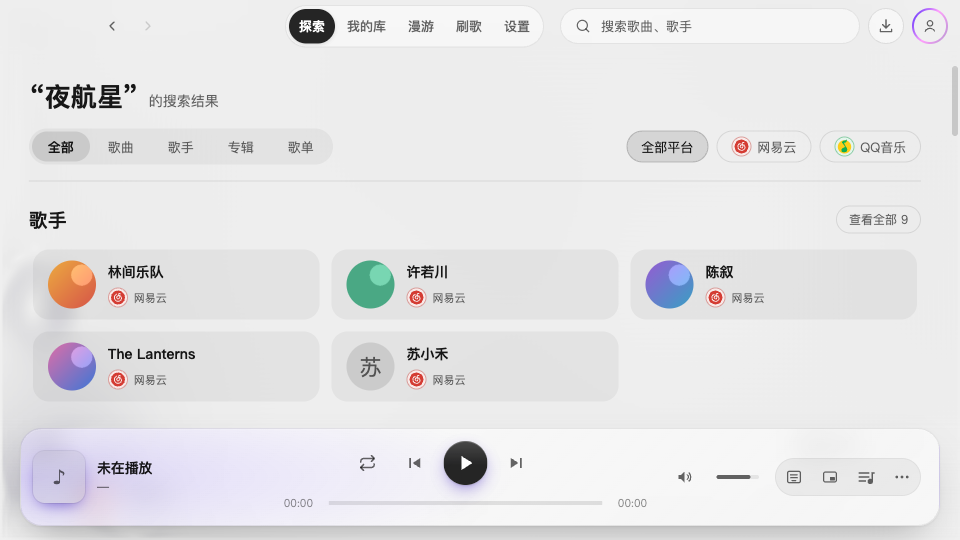 |

## 2. 我的库：减少外层套框

**此项全局去框方案已撤回。**最新实现由设置决定是否显示外框；以下图片记录曾经的改动，不代表当前“保留边框”模式。

移除货架外围的底板和边框，保留歌单卡片、新建、刷新和来源信息。标题、分类与内容共用起线，层级更直接。卡片自身阴影仍在，并非所有容器效果都已去除。

| 修改前 · 浅色 1536×864 | 修改后 |
| --- | --- |
| 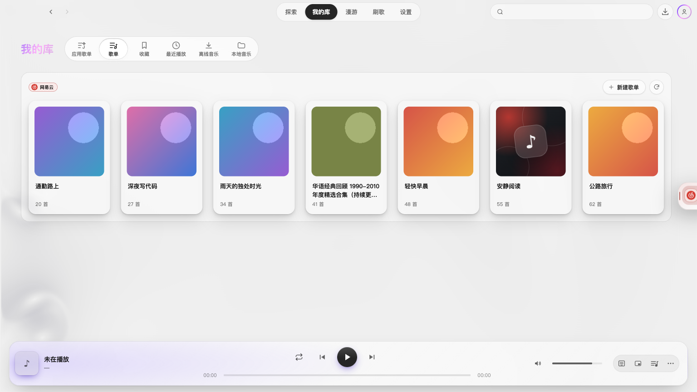 | 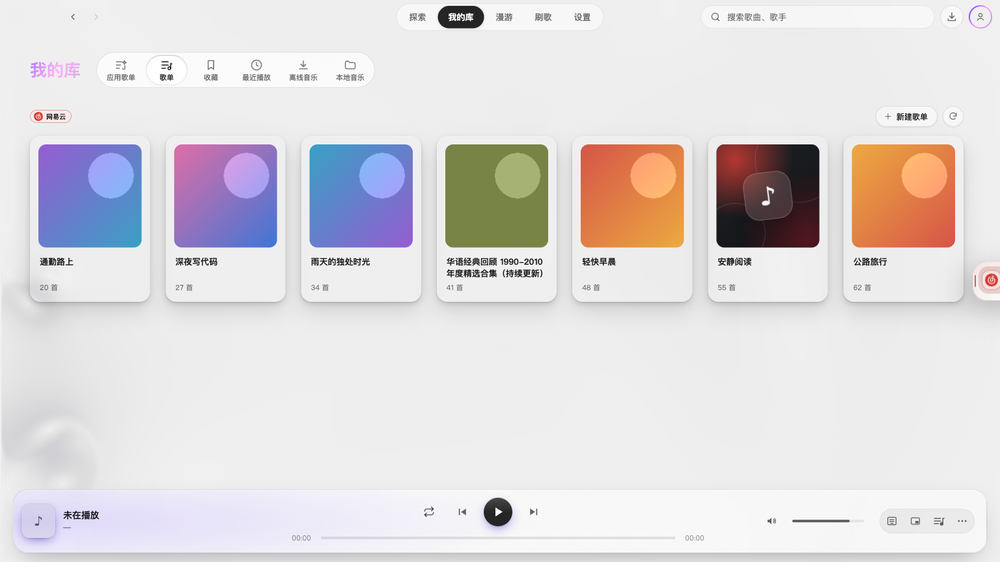 |

## 3. 歌手：统一内容起线，限制简介行长

**截图更正：**首轮截图脚本对所有动画调用 `finish()`，错误地把歌手页随滚动移动的栏目提前推进吸顶位置；未滚动时栏目从 y=346 跳到 y=52，造成“栏目在歌手信息上方”的假象。页面源码顺序始终是歌手信息、栏目、内容列表。本项原截图验收遗漏了该异常。现已修正脚本，重拍收起/展开、深浅主题、大小窗口共 8 组前后截图（16 张），以本文件现有图片为准。修改前来自独立的 clean 基准工作区，本次没有改动产品源码。

[截图错位的实测证据与滚动探针记录](assets/2.4.1-ui-alignment/artist-toolbar-settle-evidence.json)：基准版滚动后吸顶、回顶复位通过；修改版单次打开可滚动，但重复重载和导航的探针出现两个歌手页/工具栏，吸顶检查未通过，未继续调查。记录保留失败结果，没有把重拍成功等同于所有导航与滚动路径通过。

简介限制在 640px 的阅读列内，展开后仍能在原区域滚动阅读全文；返回入口、标签栏与列表沿同一内容起线排列。调整封面与文字的间距，保留原来的大封面结构。

| 修改前 · 浅色 1536×864，简介展开 | 修改后 |
| --- | --- |
| 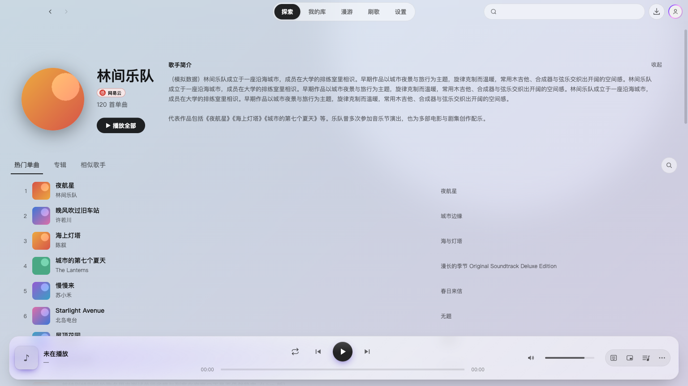 | 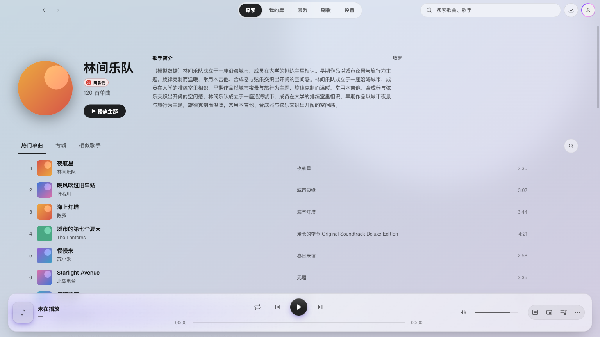 |

## 4. 歌单详情与歌曲行：边距、列距和时长更一致

详情页接入公共页面边距；歌曲信息列与专辑列重新分配空间，专辑起点靠近歌名，时长常驻。超长文字继续省略。小窗口详情页的封面和信息仍占较大首屏，曲目列表需要滚动，这是本轮保留的结构。

| 修改前 · 浅色 960×540 | 修改后 |
| --- | --- |
| 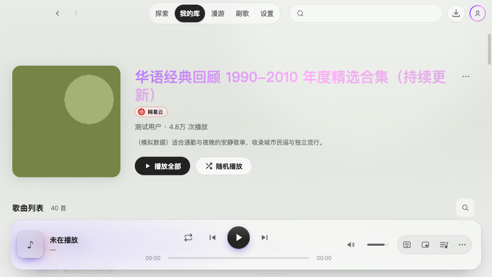 | 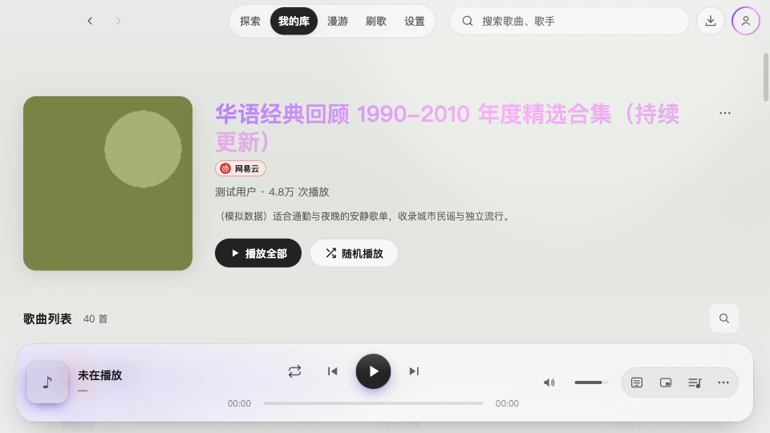 |

## 5. 探索与漫游：收紧比例，减少装饰

探索推荐区的叠放封面向旁边内容靠拢，减少空档；漫游移除英文装饰标签，缩小横幅标题与留白。保留已有推荐内容和交互，没有更换整套设计语言。

| 修改前 · 探索，浅色 1536×864 | 修改后 |
| --- | --- |
| 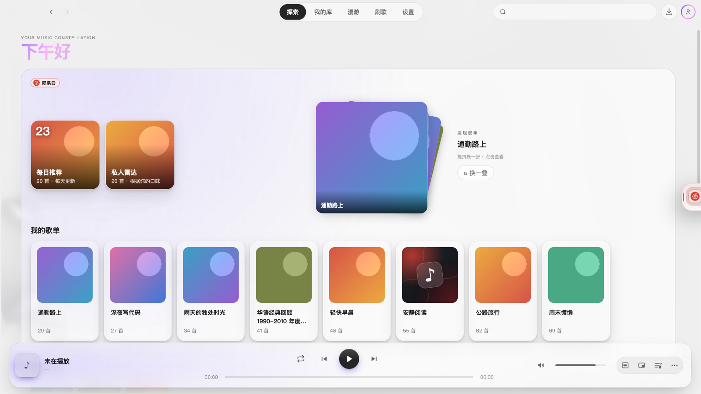 | 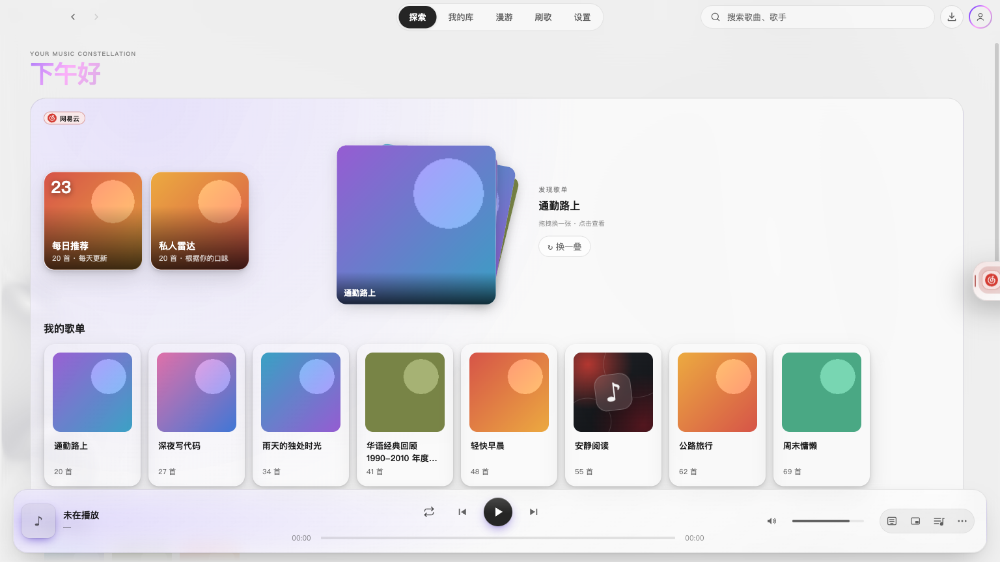 |

| 修改前 · 漫游，深色 1536×864 | 修改后 |
| --- | --- |
| 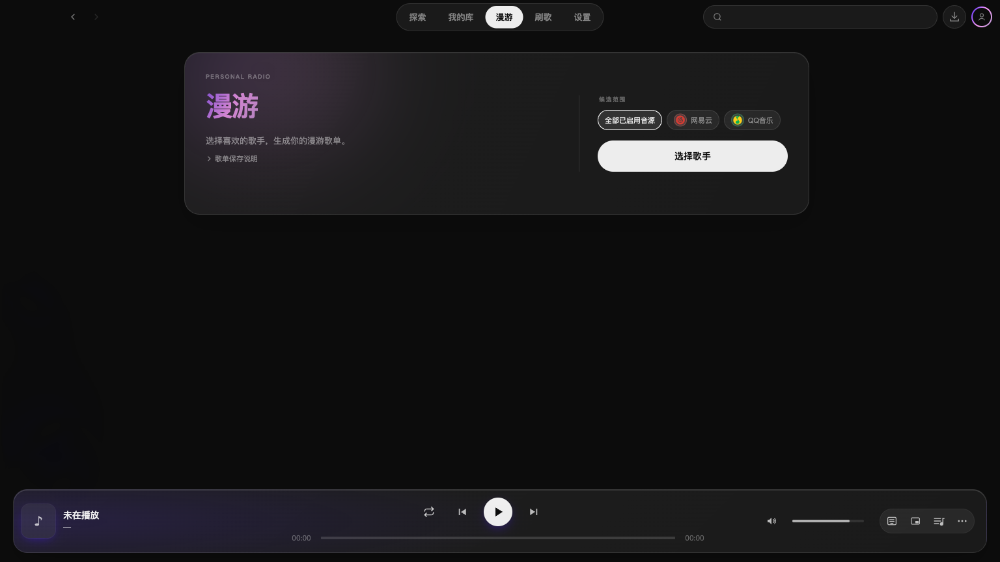 | 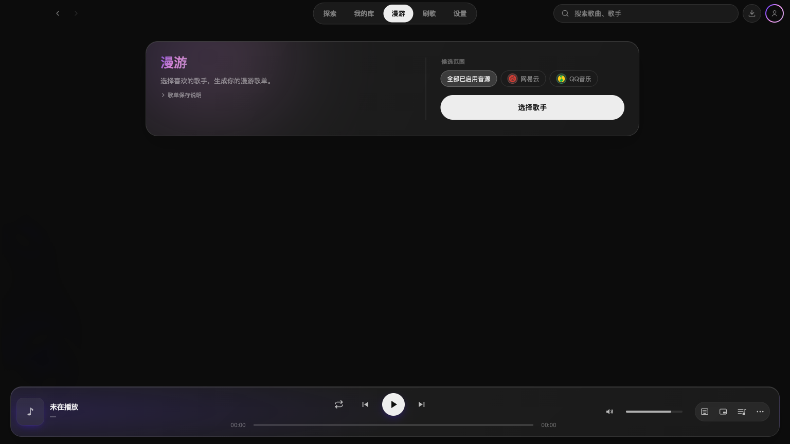 |

## 6. 弹层与顶栏：统一尺寸和用途提示

常规弹层统一标题、内边距、圆角及按钮节奏；应用歌单关闭按钮使用公共关闭图标。关闭窗口失败说明使用危险色。顶栏补充搜索用途提示，收紧头像和图标尺寸。

| 修改前 · 关闭失败，深色 960×540 | 修改后 |
| --- | --- |
| 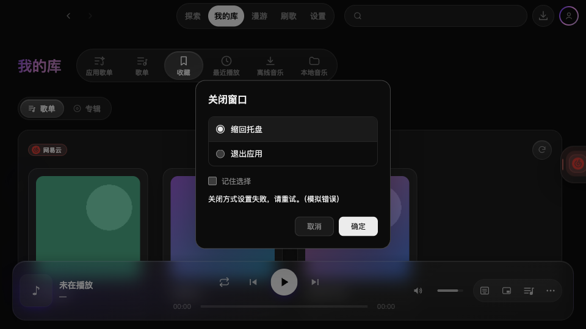 | 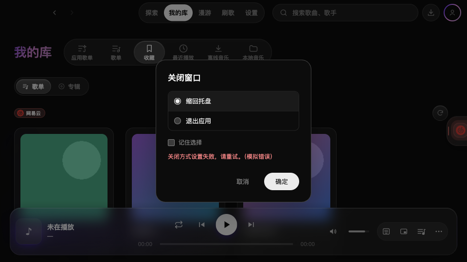 |

| 修改前 · 新建歌单，浅色 960×540 | 修改后 |
| --- | --- |
| 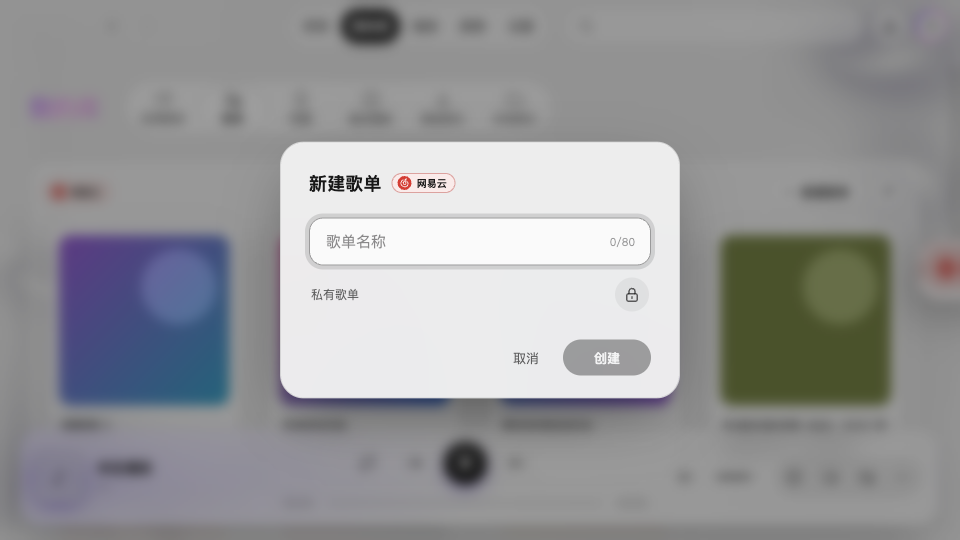 | 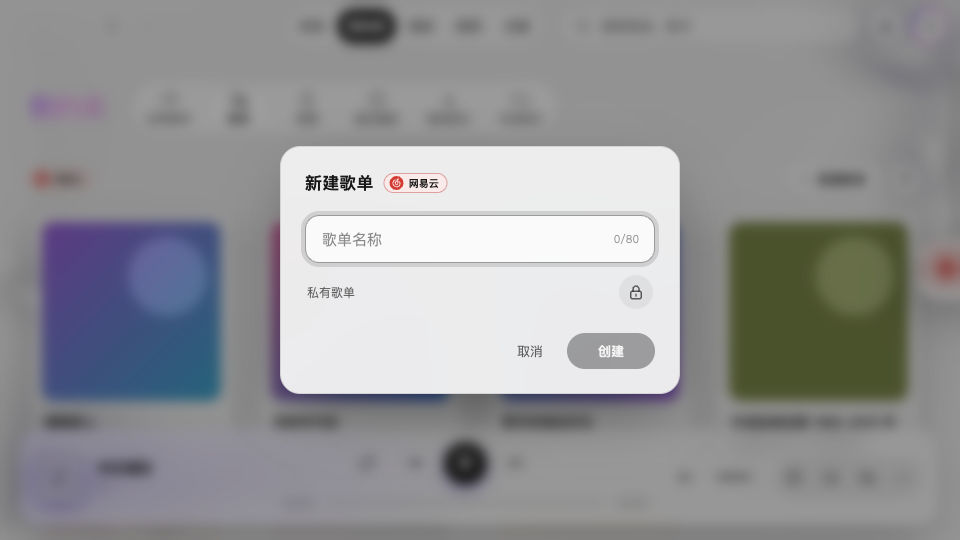 |

## 补充检查：小窗口悬停与应用歌单弹窗

在 960×540 的深浅主题中补查长标题、长专辑、暂无版权行，以及歌单详情行。加入歌单、离线保存和红心操作在适用行中没有发现重叠或裁切，长文字保持省略号；时长与不可播放原因保留。

| 修改后 · 深色，长歌名悬停 | 修改后 · 浅色，长专辑悬停 |
| --- | --- |
|  |  |

应用歌单删除弹窗的关闭图标、“取消”均能关闭且保留歌单；重命名为空或纯空格时禁用保存。删除动作没有实际执行。

**单独记录的疑点：**补充脚本按 Esc 后，应用歌单删除弹窗没有关闭。本分支对该组件仅替换关闭图标，没有改键盘处理；尚未在基准提交上复测，不能据此断言是已确认的旧问题或新回归。本轮保留此记录，未扩大源码修改。

## 验证与证据边界

- 截图共 52 对，覆盖 14 个页面或状态。常规场景覆盖深浅主题、1536×864 和 960×540；空结果与错误状态各拍摄两种组合。104 张原图的路径和尺寸已核对。
- Codex 首轮实际逐图复核 13 对代表截图，包括大/小窗口搜索、我的库、歌手收起/展开、歌单详情、探索、漫游及三类弹层和错误状态；并复核受影响源码。后续发现歌手页截图异常，重新复核更正后的代表图和 16 张截图的位置记录；首轮验收遗漏及原因见第 3 节。未把自动配对成功等同于逐张视觉验收。
- Codex 独立执行 `npm run typecheck` 通过；搜索、漫游、顶栏及搜索预览的 4 个测试文件共 19 项通过；`git diff --check` 通过。搜索 SSR 测试有既有 `useLayoutEffect` 提示，不影响通过。
- Claude 报告全量 336 个测试文件、3117 项通过；首轮 [15 项交互记录](assets/2.4.1-ui-alignment/interactions.json)通过。全量测试未由 Codex 再次运行，归因单独列出。
- Claude 按独立复核要求补齐 [19 项检查及 17 张补充截图](assets/2.4.1-ui-alignment/supplemental/results.json)，全部断言通过，页面错误为空；Esc 观察单独记录，不计为通过项。覆盖各类“查看全部”、切换来源/分类清空多选、完整队列命令、悬停操作和应用歌单弹窗。Codex 复核脚本、结果及代表补充截图。
- 平台数据、封面和错误均为明确的模拟 fixture，使用独立 Electron 开发实例及用户数据目录；没有验证真实账号、真实音频和 Windows。播放验证仅检查命令/队列范围，不能代替实际音频验收。
- 流体氛围有少量像素噪声，推荐日期取拍摄当天；不能仅凭像素差异率判断质量。
- 歌单预览小窗口中，底部播放器与预览区域的既有层叠仍保留。本轮没有重构播放栏。
- HTML 已检查内嵌脚本语法与图片路径；内置浏览器拒绝 `file://` 预览，因此没有完成 HTML 在该浏览器中的渲染验收。本 Markdown 可直接阅读前后原图。

设置页过密、说明文字过多和留白不足仍是已知问题，按用户决定留待后续重构；本轮不把它列为已完成。
