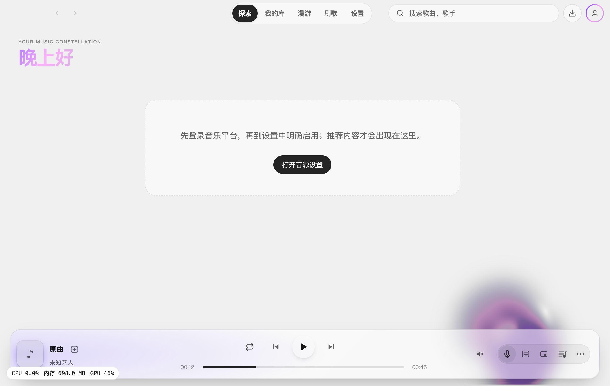
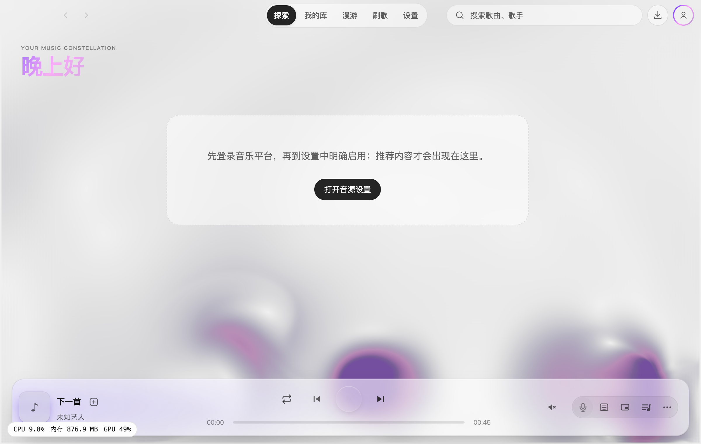
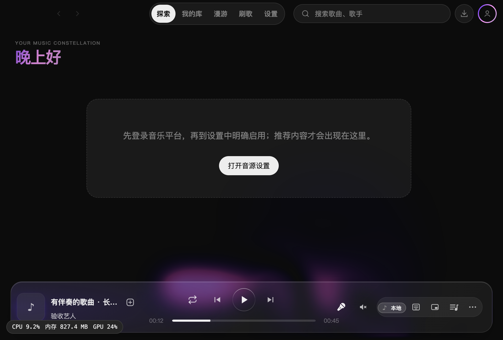
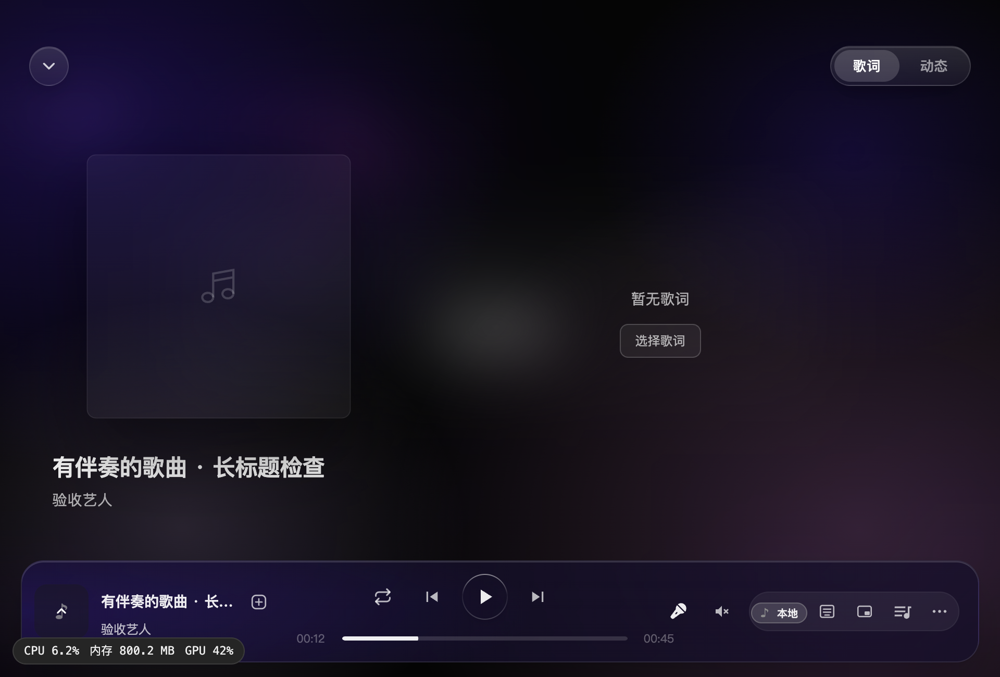

# 播放栏伴奏模式验收

麦克风位于音量喇叭左侧。按原曲平台与 ID 识别已生成成品；优先当前所选模型，否则使用最近的可用版本。没有成品时置灰并提示生成入口，开启后高亮，再次点击返回原曲。

## 验证

- 两套 TypeScript 检查通过，全量 Vitest 372 个文件、3493 项通过；最后的文件失败起播位置修正另通过 3 个文件、81 项回归。
- 独立复核已处理歌词偏移重置、独立伴奏歌词归属、暂停淡出及自然结束的播放意图问题。
- macOS 的实际 Electron 开发实例使用隔离资料与两段 45 秒 WAV，已验证暂停切换、播放中往返、实际音频 ID 与定位、歌词偏移保留、队列保持、切歌复位、文件缺失回原曲；无页面异常。结果见 [运行记录](assets/2026-10-27-accompaniment-mode/verification.json)。
- 深浅主题与 960 × 650 小窗口、在线原曲搭配本地伴奏来源徽标、歌词页按钮及悬停提示均已检查，胶囊未越界。未执行生产构建或 Windows 安装包检查。

