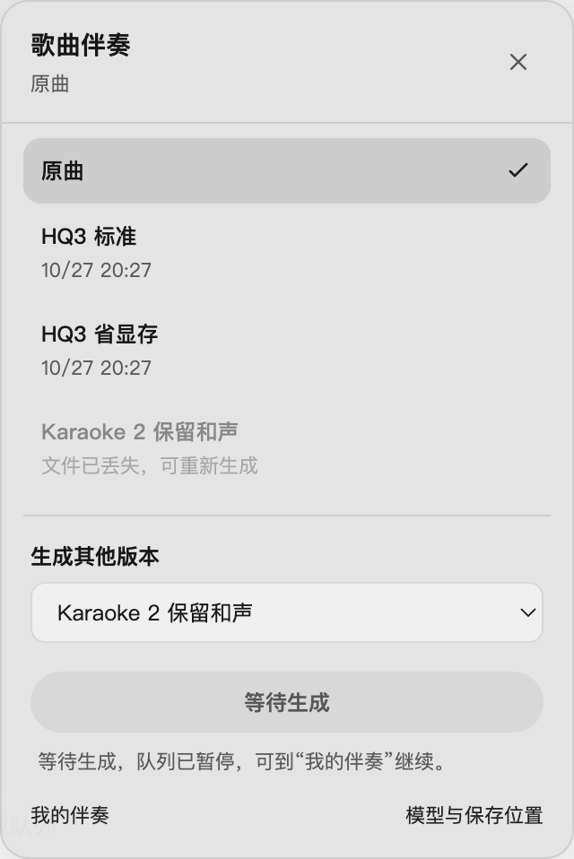
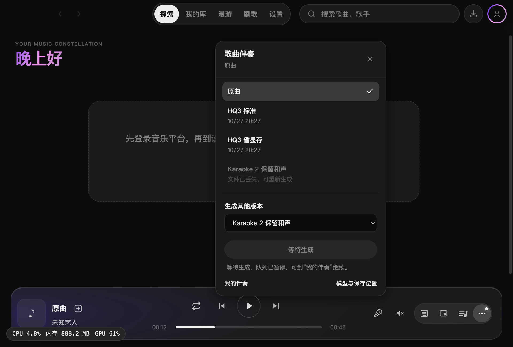
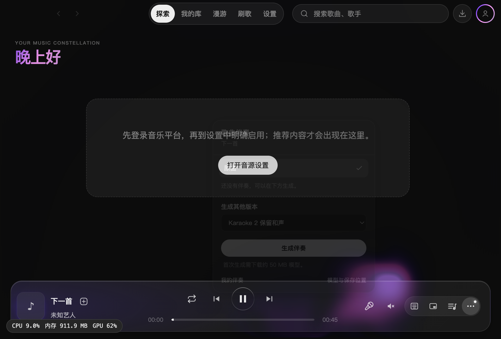

# 伴奏版本选择面板验收

麦克风仍位于音量喇叭左侧，点击打开当前歌曲的版本面板。用户可选择原曲或某一已生成版本，也可选择模型生成其他版本。面板标出当前选择和丢失文件；已有成品或在途任务禁止重复生成，失败任务可重试。

## 验证

- 两套 TypeScript 检查通过；全量 Vitest 373 个文件、3503 项通过；最后的关闭交互调整后，8 个文件、116 项回归通过。
- 独立复核发现并修复旧异步选择关闭新面板、QQ 补齐 mid 后任务漏识别的问题。库版本匹配、生成任务去重与恢复检查使用同一歌曲身份规则。
- macOS 隔离 Electron 实例验证：点击只展开；两个可用伴奏版本精确切换；丢失版本禁用；原曲往返保留 12 秒位置、暂停状态、0.7 秒歌词偏移与队列；选择另一模型入队后不改变播放；切歌关闭面板；没有伴奏也能打开生成入口；关闭按钮与点击外部关闭正常。
- 生成入队使用暂停的隔离队列验证，本轮未重复运行模型推理。无页面异常。深浅主题、960 × 650 小窗口已检查，面板完整显示；未运行生产构建及 Windows 安装包。详见[运行记录](assets/2026-10-27-accompaniment-picker/verification.json)。

