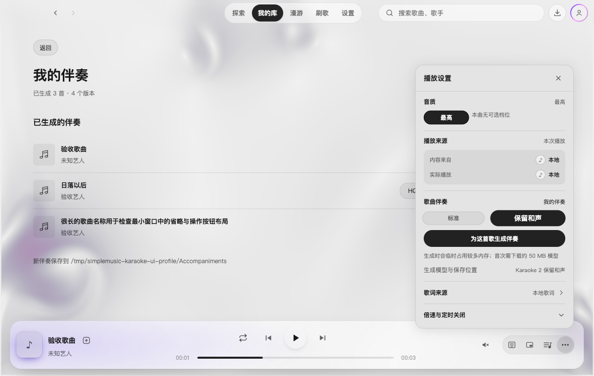
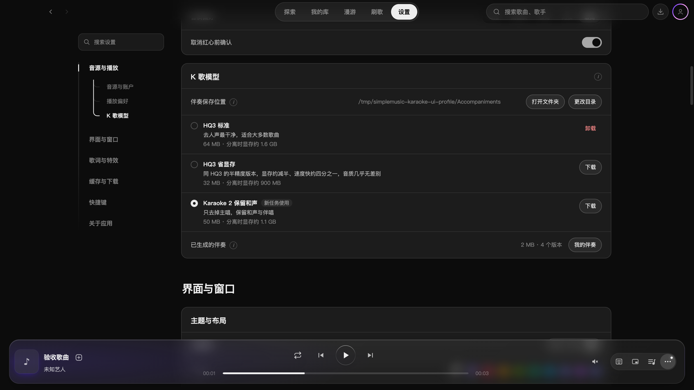

# 伴奏生成队列验收

本次将 K 歌开关改为显式的单曲生成任务，独立队列逐首处理；切歌不取消、不自动解析下一首。我的库的应用歌单中固定显示“我的伴奏”，每首歌曲可切换已生成的模型版本，保存位置可设置。成品长期保留，不参与缓存淘汰或模型卸载。

## 验证

- `npm run typecheck` 通过；全量 Vitest 363 个文件、3419 项测试通过。
- 独立复核的问题已修复并回归覆盖：歌词沿用原曲、本地封面换端口重建、Portable 复制目录不误删旧副本、目录查询过期响应、退出时文件已发布但回执未到的任务去重。
- macOS 的实际 Electron 开发实例使用隔离资料：3 秒本地音频通过 HQ3 生成伴奏，过程中切换播放另一首，生成仍完成；辅助进程退出。播放生成文件能读取原曲歌词，切回原曲保留 1 秒位置。取消排队任务、多个模型版本、菜单跳转关闭、普通歌单与固定入口并列均已检查。
- 进程内存采样峰值约 1980 MiB，任务结束回落至约 811 MiB，详见[采样摘要](assets/2026-10-27-accompaniments/generation-check.json)。这是短样本与开发实例的采样，不是整首歌曲或不同硬件的峰值上限。
- Windows 安装版和 Portable 的路径与复制场景由代码及回归测试验证，尚未运行 Windows 安装包。未执行生产打包。

## 实际界面

截图使用隔离的测试歌曲与模型记录；队列截图的任务处于暂停状态。

